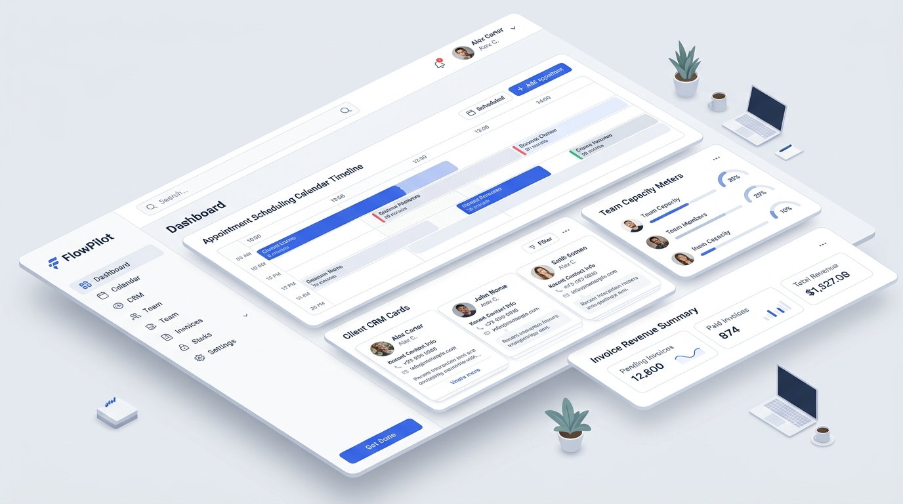
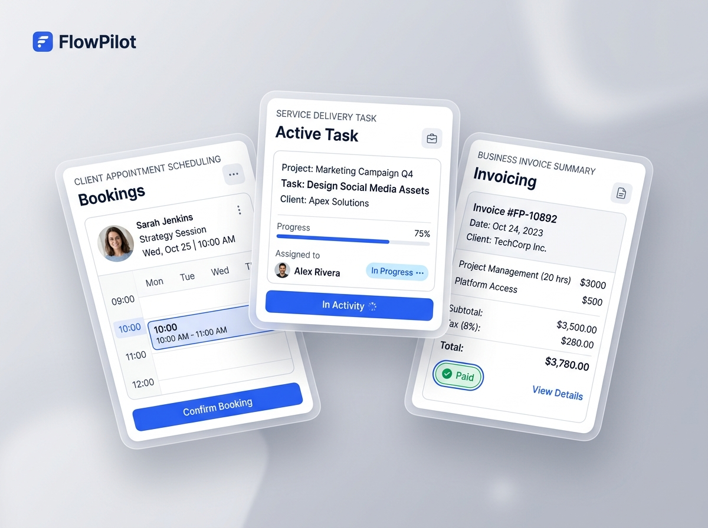
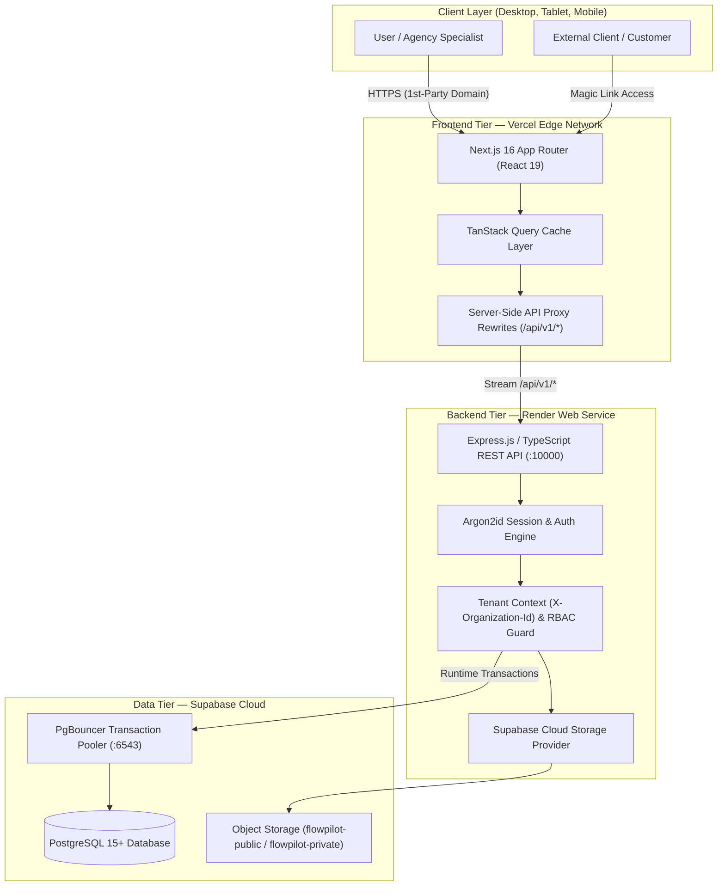

# FlowPilot — Multi-Tenant Business Operations SaaS Platform

[](https://nextjs.org/)
[](https://react.dev/)
[](https://www.typescriptlang.org/)
[](https://tailwindcss.com/)
[](https://tanstack.com/query)
[](https://www.radix-ui.com/)
[](https://vitest.dev/)
[](https://playwright.dev/)

> **"One unified operations platform for modern service businesses, digital agencies, and consultancies."**

FlowPilot is a full-stack, multi-tenant Business Operations SaaS engineered to centralize fragmented agency workflows into one unified, type-safe workspace. It unifies client CRM, specialist shift scheduling, collision-free appointment booking, digital quotes with cryptographic signature ceremonies, strictly sequential invoicing, and automated recurring retainers.

This repository (`flowpilot`) contains the standalone frontend application layer, built with **Next.js 16 App Router**, **React 19**, **Tailwind CSS 4**, and **Radix UI**, connecting over a typed REST client to the [`flowpilot-backend`](https://github.com/iamrakibhussain/flowpilot-backend) API engine.

---

## Table of Contents

- [1. Product Overview & Purpose](#1-product-overview--purpose)
- [2. Target Users & Use Cases](#2-target-users--use-cases)
- [3. Key Implemented Capabilities](#3-key-implemented-capabilities)
- [4. Visual Showcase & Screenshots](#4-visual-showcase--screenshots)
- [5. System Architecture & Topology](#5-system-architecture--topology)
- [6. Frontend Engineering & Architecture](#6-frontend-engineering--architecture)
- [7. Technology Stack](#7-technology-stack)
- [8. Project Directory Structure](#8-project-directory-structure)
- [9. Local Development & Installation](#9-local-development--installation)
- [10. Environment Variables Configuration](#10-environment-variables-configuration)
- [11. Testing & Code Quality](#11-testing--code-quality)
- [12. Deployment Architecture](#12-deployment-architecture)
- [13. Portfolio Demonstration Limitations](#13-portfolio-demonstration-limitations)
- [14. Product Roadmap](#14-product-roadmap)
- [15. Documentation Directory](#15-documentation-directory)
- [16. Author & License](#16-author--license)

---

## 1. Product Overview & Purpose

### The Problem

Growing service businesses, digital consultancies, and creative agencies frequently operate across a fragmented software stack:

- **Scattered Customer Data:** Leads in spreadsheets, notes in separate CRMs, and email chains.
- **Scheduling Conflicts:** Double-booked specialists, timezone miscalculations, and uncoordinated shift handoffs.
- **Disconnected Sales-to-Billing Pipeline:** Quotes sent via email PDFs, signatures captured on third-party tools, and invoices typed manually into accounting software.
- **Client Friction:** External clients lack a consolidated portal to review project milestones, sign proposals, and settle outstanding balances.

### The FlowPilot Solution

FlowPilot eliminates operational silos by establishing a **single source of truth** across the entire service delivery lifecycle:

1. **Self-Service Onboarding:** Tenants provision an isolated workspace in seconds via `/register`.
2. **Specialist Allocation:** Real-time appointment scheduling with buffer rules and collision prevention.
3. **Cryptographic Contracting:** Legal proposals with digital signatures and immutable audit trails.
4. **Collision-Free Invoicing:** Organization-scoped sequential invoice numbering and Stripe payments.
5. **Client Transparency:** Dedicated magic-link client portals for self-service invoice settlement.

---

## 2. Target Users & Use Cases

| Target Segment                          | Primary Workflow in FlowPilot                                                                                                                   |
| :-------------------------------------- | :---------------------------------------------------------------------------------------------------------------------------------------------- |
| **Digital Agencies & Creative Studios** | Manage client discovery calls, deliver multi-tier service retainers, send digital design proposals for signature, and issue milestone invoices. |
| **IT & Strategy Consultancies**         | Schedule specialist audits, track executive consulting contracts, manage shift availability, and automate monthly retainer billing.             |
| **Professional Service Teams**          | Maintain verified customer CRM records, provide branded self-service client portals, and securely store contracts in cloud object storage.      |

---

## 3. Key Implemented Capabilities

- 🏢 **Multi-Tenant Organization Workspaces:** Complete logical boundary enforcement per workspace. Users can belong to multiple organizations with distinct roles (`OWNER`, `ADMIN`, `MEMBER`).
- 📊 **Real-Time Operations Dashboard:** Live revenue counters, invoice reconciliation states, upcoming specialist schedules, and customer velocity metrics driven by TanStack Query.
- 📅 **Collision-Free Appointment Engine:** Specialist shift allocation, buffer time management, and double-booking prevention across team calendars.
- 👥 **Customer CRM & Roster Coordination:** Centralized customer directories, specialist availability states (`AVAILABLE`, `IN_SESSION`, `ON_BREAK`), and contact histories.
- ✍️ **Digital Proposals & Signature Ceremonies:** Interactive quote builder with scope line items, client signature pad, cryptographic SHA-256 document checksums, and audit trails.
- 🧾 **Sequential Invoicing & Stripe Integration:** Strictly sequential, collision-free invoice numbering with Stripe Checkout integration (Test Mode configured).
- 🔁 **Recurring Retainers Engine:** Automated monthly and annual recurring retainer billing schedules.
- 🌐 **Client Self-Service Portal (`/portal/[slug]`):** Dedicated passwordless, magic-link authenticated portal allowing external clients to review appointments, inspect statements, and settle invoices.
- 🗄️ **Cloud Storage Integration:** Native Supabase Storage supporting direct CDN streaming for public branding/avatars and 900-second cryptographic signed URLs for private contracts.
- 📱 **Product-Wide Responsive Design:** Validated across 8 distinct viewports (320px to 1920px) with touch-friendly navigation drawers and zero horizontal overflow.

---

## 4. Visual Showcase & Screenshots

### Live Homepage & Operations Workflow

|                              Operations Dashboard Preview                              |                               Operations Workflow & Features                               |
| :------------------------------------------------------------------------------------: | :----------------------------------------------------------------------------------------: |
|  |  |
|             _Live operations dashboard showcasing metrics and schedules._              |                _Centralized service operations and appointment management._                |

### Application View Gallery (Documented Interface Inventory)

| Viewport / Screen         | Route                     | Key UI Features & Interactivity                                                                          |
| :------------------------ | :------------------------ | :------------------------------------------------------------------------------------------------------- |
| **Public Landing Page**   | `/`                       | GPU-accelerated Aurora background, responsive header, feature cards, and interactive FAQ accordion.      |
| **Tenant Onboarding**     | `/register`               | Atomic workspace name, slug generation, user credentials, and security guarantees badge.                 |
| **Operations Dashboard**  | `/dashboard`              | Metric summary cards, upcoming appointment lists, recent invoice ledger, and quick-action menu.          |
| **Specialist Scheduling** | `/dashboard/appointments` | Specialist calendar grid, appointment modal, status badge indicators, and buffer-time validation.        |
| **Invoicing & Billing**   | `/dashboard/invoices`     | Sequential numbering (`INV-YYYY-XXXX`), status filters (`PAID`, `PENDING`, `OVERDUE`), and PDF export.   |
| **Digital Proposals**     | `/dashboard/quotes`       | Scope builder, discount/tax calculations, and direct signature invitation dispatch.                      |
| **Client Portal Hub**     | `/portal/[slug]`          | Passwordless magic-link sign-in, appointment history, and one-click invoice payment checkout.            |
| **Workspace Settings**    | `/dashboard/settings`     | Multi-tenant organization profile, team member invitations, role management, and branding customization. |

---

## 5. System Architecture & Topology

FlowPilot operates as a decoupled modern SaaS architecture. To eliminate browser third-party cookie restrictions (Safari ITP, Chrome Privacy Sandbox), Next.js App Router serves as a **secure reverse proxy** to the upstream Express API.



---

## 6. Frontend Engineering & Architecture

### 6.1 App Router Structure & Route Grouping

The application uses Next.js 16 nested route groups to isolate layouts and middleware concerns cleanly:

- `(public)` — Marketing homepage, pricing breakdown, and FAQ with public navigation layout.
- `(auth)` — Authentication flows (`/login`, `/register`, `/forgot-password`, `/reset-password`, `/verify-email`).
- `(dashboard)` — Authenticated workspace operations (`/dashboard/*`) wrapped with sidebar navigation, tenant command palette, and header context switcher.
- `portal` — Dedicated client self-service portal (`/portal/[slug]/*`) with specialized layout.
- `book` / `pay` / `quote` — Standalone, distraction-free external public touchpoints.

### 6.2 Zero Third-Party Cookie Blocking

Traditional cross-domain architectures (e.g. `vercel.app` frontend calling `onrender.com` backend directly) face severe cookie blocking on modern browsers. FlowPilot resolves this completely through server-side rewrites in `next.config.ts`:

```ts
async rewrites() {
  const backendUrl =
    process.env.BACKEND_API_URL ||
    process.env.NEXT_PUBLIC_API_BASE_URL ||
    "http://localhost:4000/api/v1";
  const backendOrigin = backendUrl.replace(/\/api\/v1\/?$/, "");
  return [
    {
      source: "/api/v1/:path*",
      destination: `${backendOrigin}/api/v1/:path*`,
    },
  ];
}
```

All API requests execute as **first-party requests** to `/api/v1/*`, ensuring `HttpOnly; SameSite=lax; Secure` session cookies function reliably across all browsers.

### 6.3 State Management & Data Fetching

- **Server Cache & Invalidation:** TanStack Query handles server state with optimistic UI updates and cache key scoping (`['customers', activeOrgId]`, `['invoices', activeOrgId]`).
- **Client Form State:** React Hook Form coupled with Zod schemas guarantees strict client-side validation before network dispatch.
- **Tenant Context Injection:** The custom `ApiClient` automatically extracts the active workspace ID and attaches the `X-Organization-Id` header to every outgoing request.

---

## 7. Technology Stack

| Layer               | Technology                     | Version  | Purpose                                                |
| :------------------ | :----------------------------- | :------- | :----------------------------------------------------- |
| **Framework**       | Next.js (App Router)           | `16.4.2` | Server Components, Turbopack, nested route layouts     |
| **Runtime Library** | React                          | `19.3.0` | Declarative UI rendering, concurrent transitions       |
| **Language**        | TypeScript                     | `5.7+`   | Strict compile-time type verification (`strict: true`) |
| **Styling**         | Tailwind CSS                   | `4.0.0`  | Modern CSS tokens, `@theme` configuration              |
| **Primitives**      | Radix UI                       | Latest   | Accessible Dialog, DropdownMenu, Tabs, and Slot        |
| **Data Fetching**   | TanStack Query                 | `5.0.0`  | Server state synchronization, optimistic mutations     |
| **Form Engine**     | React Hook Form + Zod          | Latest   | Form state orchestration and runtime schema validation |
| **Icons & Motion**  | Lucide React / Framer Motion   | Latest   | Accessible iconography and layout transitions          |
| **Unit Testing**    | Vitest & React Testing Library | `5.0.4`  | Component and unit test execution in jsdom             |
| **E2E Testing**     | Playwright                     | Latest   | Responsive cross-viewport testing (320px to 1920px)    |

---

## 8. Project Directory Structure

```ascii
flowpilot/
├── docs/                       # Comprehensive architectural and deployment documentation
│   ├── deployment/             # Portfolio demo setup, environment matrix, and safety
│   └── portfolio/              # Recruiter demo walkthrough script and interview notes
├── public/                     # Static branding assets and application showcase images
│   └── images/homepage/        # Dashboard previews and workflow assets
├── src/
│   ├── app/                    # Next.js App Router tree
│   │   ├── (auth)/             # Authentication routes (login, register, reset, verify)
│   │   ├── (dashboard)/        # Main operations workspace (appointments, invoices, CRM)
│   │   ├── (public)/           # Public landing, pricing, and FAQ pages
│   │   ├── book/               # Public appointment scheduling booking widget
│   │   ├── pay/                # Public invoice settlement portal
│   │   ├── portal/             # Client self-service portal hub (/portal/[slug])
│   │   └── quote/              # Digital quote proposal signature viewer
│   ├── components/             # Reusable UI component catalog
│   │   ├── dashboard/          # Domain-specific workspace widgets
│   │   ├── feedback/           # Alert banners, empty states, and toast notifications
│   │   ├── layout/             # Header, sidebar, command palette, navigation
│   │   └── ui/                 # Accessible Radix primitives and button controls
│   ├── features/               # Modular business feature services and queries
│   │   ├── appointments/       # Scheduling hooks, types, and API mutations
│   │   ├── auth/               # Session queries, login mutations, and profile state
│   │   ├── customers/          # CRM directory queries and customer mutations
│   │   ├── invoices/           # Invoicing hooks and Stripe checkout handlers
│   │   └── storage/            # Cloud file upload hooks and signed URL resolvers
│   └── lib/                    # Foundation infrastructure
│       ├── api/                # Typed ApiClient, fetch wrappers, and error normalizers
│       └── utils/              # ClassName mergers (cn), formatters, and helpers
├── tests/                      # Testing suites
│   ├── e2e/                    # Playwright responsive matrix and smoke specs
│   └── unit/                   # Foundation and middleware unit tests
├── next.config.ts              # API proxy rewrites and HTTP security headers
├── tailwind.config.ts          # Tailwind CSS theme extensions
└── tsconfig.json               # Strict TypeScript configuration
```

---

## 9. Local Development & Installation

### Prerequisites

- **Node.js:** `v20.x LTS` or `v24.x LTS`
- **Package Manager:** `npm` (v10+)
- **Backend Service:** Running [`flowpilot-backend`](https://github.com/iamrakibhussain/flowpilot-backend) instance on port `4000`

### Setup Instructions

1. **Clone the repository:**

   ```bash
   git clone https://github.com/iamrakibhussain/flowpilot.git
   cd flowpilot
   ```

2. **Install project dependencies:**

   ```bash
   npm install
   ```

3. **Configure local environment variables:**

   ```bash
   cp .env.example .env.local
   ```

   _(The default template is pre-configured to connect to the local backend at `http://localhost:4000/api/v1`)_

4. **Start the local development server:**
   ```bash
   npm run dev
   ```
   Open [http://localhost:3000](http://localhost:3000) in your browser.

---

## 10. Environment Variables Configuration

Frontend configuration is managed via `.env.local` in development and Vercel Project Settings in production:

| Variable Name                        | Required       | Default / Example                          | Description                                              |
| :----------------------------------- | :------------- | :----------------------------------------- | :------------------------------------------------------- |
| `NEXT_PUBLIC_APP_ENV`                | **Yes**        | `development` / `production`               | Application runtime environment mode.                    |
| `NEXT_PUBLIC_APP_URL`                | **Yes**        | `http://localhost:3000`                    | Canonical origin URL of the web frontend.                |
| `NEXT_PUBLIC_API_BASE_URL`           | **Yes**        | `http://localhost:4000/api/v1`             | Base REST API URL accessed by frontend fetch calls.      |
| `BACKEND_API_URL`                    | **Yes** (Prod) | `https://your-backend.onrender.com/api/v1` | Target backend URL for Next.js server-side rewrites.     |
| `NEXT_PUBLIC_API_TIMEOUT_MS`         | Optional       | `15000`                                    | HTTP client request timeout in milliseconds.             |
| `NEXT_PUBLIC_ENABLE_MOCKS`           | Optional       | `false`                                    | Isolated mock data mode (must be `false` in production). |
| `NEXT_PUBLIC_STRIPE_PUBLISHABLE_KEY` | Optional       | `pk_test_...`                              | Stripe publishable key for Test Mode card checkouts.     |

---

## 11. Testing & Code Quality

FlowPilot enforces strict code verification standards across unit, component, and responsive dimensions:

```bash
# Run complete pre-commit validation pipeline (type-check + lint + format:check + unit tests):
npm run validate

# Run Vitest unit & component test suite (71 tests across 17 files):
npm run test:unit

# Run TypeScript compiler type-check:
npm run type-check

# Run ESLint static analysis:
npm run lint

# Run Playwright responsive viewport matrix audit (Mobile, Tablet, Desktop):
npx playwright test tests/e2e/responsive-audit.spec.ts
```

---

## 12. Deployment Architecture

The recommended portfolio deployment pairs **Vercel** with **Render** and **Supabase**:

- **Frontend Hosting:** Vercel Hobby Tier (`https://[your-app].vercel.app`)
- **Backend Hosting:** Render Web Service Free Tier (`https://[your-backend].onrender.com`)
- **Database & Storage:** Supabase Cloud (`PostgreSQL 15+` & Object Storage buckets)

Refer to the complete deployment guides in `/docs/deployment/`:

- [Portfolio Demo Architecture](docs/deployment/portfolio-demo-architecture.md) — Detailed networking flows and proxy diagrams.
- [Portfolio Demo Setup Walkthrough](docs/deployment/portfolio-demo-setup.md) — Step-by-step setup instructions for Render and Vercel.
- [Environment Variables Reference](docs/deployment/environment-variables.md) — Complete environment mapping matrix.

---

## 13. Portfolio Demonstration Limitations

This deployment is configured specifically as a **public portfolio demonstration**:

- 💳 **Test-Mode Financial Processing:** Stripe runs strictly in Test Mode using mock keys (`pk_test_...`); no real credit cards are charged.
- ✉️ **Console Email Transport:** Transactional emails are logged to the backend console rather than sent via external SMTP relays to avoid spam risks.
- ⏱️ **Render Free-Tier Cold Starts:** The free-tier backend instance spins down after 15 minutes of inactivity. Initial requests after sleep may take ~30–50 seconds to warm up.

---

## 14. Product Roadmap

- [ ] **Stripe Connect Multi-Tenant Onboarding:** Direct payouts and fee splitting for agency specialists.
- [ ] **Native WebSocket Live Notifications:** Instant UI sync when clients sign proposals or pay invoices.
- [ ] **Custom Domain White-Labeling:** Allow agencies to map custom subdomains (`ops.agency.com`).
- [ ] **Automated PDF Export Worker:** Native background PDF generation for signed contracts and statements.

---

## 15. Documentation Directory

Detailed technical and evaluation guides are maintained in `/docs`:

- [Recruiter Demo Walkthrough Script](docs/portfolio/recruiter-demo-walkthrough.md) — 5-minute guided evaluation tour.
- [Technical Interview Architecture Notes](docs/portfolio/interview-architecture-notes.md) — Architecture decisions and trade-offs.
- [Frontend Architecture Specification](docs/FRONTEND-ARCHITECTURE.md) — System boundaries, rendering strategies, and styling standards.
- [Design System Catalogue](docs/DESIGN-SYSTEM.md) — Design tokens, typography, and contrast standards.
- [API Contract Alignment Audit](docs/API-CONTRACT-ALIGNMENT-AUDIT.md) — REST envelopes, error codes, and mutation endpoints.

---

## 16. Author & License

**FlowPilot** is architected and engineered by:

**Rakib Hussain**

- **GitHub:** [@iamrakibhussain](https://github.com/iamrakibhussain)
- **Frontend Repository:** [iamrakibhussain/flowpilot](https://github.com/iamrakibhussain/flowpilot)
- **Backend Repository:** [iamrakibhussain/flowpilot-backend](https://github.com/iamrakibhussain/flowpilot-backend)

Licensed under the [MIT License](LICENSE).
