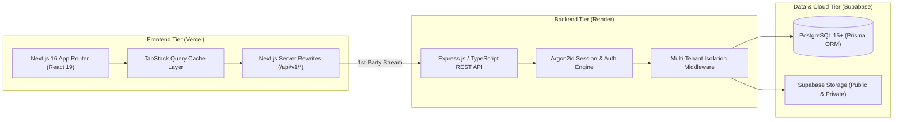

# FlowPilot — Multi-Tenant Business Operations SaaS

[](https://nextjs.org/)
[](https://react.dev/)
[](https://www.typescriptlang.org/)
[](https://tailwindcss.com/)
[](https://vitest.dev/)
[](https://playwright.dev/)

> **"One unified operations platform for modern service businesses, digital agencies, and consultancies."**

FlowPilot is a full-stack, multi-tenant Business Operations SaaS engineered to unify CRM, specialist shift scheduling, collision-free appointment booking, quotes with digital signature ceremonies, sequential invoicing, and automated Stripe billing.

This repository (`flowpilot`) contains the frontend application layer. It is built with Next.js 16 App Router, React 19, Tailwind CSS 4, and Radix UI primitives, connecting over REST to the [`flowpilot-backend`](https://github.com/iamrakibhussain/flowpilot-backend) API engine.

---

## 1. Live Portfolio Demonstration

| Resource             | URL / Access                                                            |
| :------------------- | :---------------------------------------------------------------------- |
| **Live Web App**     | `https://[your-app-name].vercel.app` _(Configured on owner deployment)_ |
| **Backend REST API** | `https://[your-backend-name].onrender.com/api/v1/health`                |
| **Portfolio Access** | Register a new tenant at `/register` or sign in with your credentials   |
| **Multi-Tenancy**    | Isolated tenant workspace per registered account                        |

_Visitors can register a fresh organization via `/register` to test the full multi-tenant onboarding flow and explore operations in an isolated workspace._

---

## 2. Key Product Capabilities

- **Strict Multi-Tenancy:** Complete tenant isolation across workspaces, memberships, and billing profiles.
- **Operations Dashboard:** Live financial metrics, active customer summaries, and upcoming specialist schedules.
- **Appointment Scheduling Engine:** Specialist shift allocation, buffer time management, and double-booking prevention.
- **Quotes & Legal Digital Signatures:** Branded client estimates with cryptographic signature ceremonies and audit trails.
- **Invoicing & Stripe Payments:** Strictly sequential, collision-free invoice generation with Stripe Checkout integration (Test Mode).
- **Recurring Retainers:** Automated monthly and annual retainer billing schedules.
- **Client Self-Service Portal:** Magic-link authenticated portal for external clients to review appointments and settle invoices.
- **Cloud Storage:** Supabase Storage integration with public CDN assets and private 900-second signed URLs.
- **Product-Wide Responsive Design:** Validated across 8 distinct viewports (320px to 1920px) with touch-friendly navigation drawers.

---

## 3. Architecture Overview



---

## 4. Technology Stack

- **Framework:** Next.js 16.4.2 (App Router with Turbopack)
- **UI Library:** React 19.3.0
- **Styling:** Tailwind CSS 4 with custom CSS variables & GPU-accelerated Aurora animations
- **Component Primitives:** Radix UI (Dialog, Dropdown Menu, Tabs, Slot)
- **Forms & Validation:** React Hook Form + Zod (Strict schema validation)
- **Data Fetching & Cache:** TanStack Query 5 (React Query with optimistic mutations)
- **Icons & Motion:** Lucide React & Framer Motion
- **Testing:** Vitest 5.0.4 (Unit & Component testing with jsdom) & Playwright (Responsive viewports & E2E smoke)

---

## 5. Local Development Setup

### Prerequisites

- Node.js 20+ LTS or Node.js 24 LTS
- Running backend service: [`flowpilot-backend`](https://github.com/iamrakibhussain/flowpilot-backend) on port 4000

### Installation Steps

1. Clone the repository:

   ```bash
   git clone https://github.com/iamrakibhussain/flowpilot.git
   cd flowpilot
   ```

2. Install dependencies:

   ```bash
   npm install
   ```

3. Configure local environment variables:

   ```bash
   cp .env.example .env.local
   ```

   _(Defaults are pre-configured for local development connecting to `http://localhost:4000/api/v1`)_

4. Start the Next.js development server:
   ```bash
   npm run dev
   ```
   Open [http://localhost:3000](http://localhost:3000) in your browser.

---

## 6. Testing & Quality Verification

FlowPilot enforces zero-tolerance code quality standards:

```bash
# Run complete validation suite (type-check, lint, format, unit tests):
npm run validate

# Run Vitest unit & component test suite (71 tests across 17 files):
npm run test:unit

# Run TypeScript strict type-check:
npm run type-check

# Run ESLint static analysis:
npm run lint

# Run Playwright responsive matrix tests:
npx playwright test tests/e2e/responsive-audit.spec.ts
```

---

## 7. Security Architecture & Safeguards

- **No Third-Party Cookie Dependency:** Next.js server-side rewrites route `/api/v1/*` to the upstream backend, allowing session cookies to operate as 1st-party cookies across modern browsers.
- **Defense in Depth:** Helmet HTTP security headers (CSP, HSTS, X-Frame-Options: DENY, X-Content-Type-Options: nosniff).
- **Session Protection:** Session tokens stored in `HttpOnly; SameSite; Secure` cookies; zero sensitive tokens stored in `localStorage`.
- **Voluntary User Logout:** Users remain authenticated until they explicitly click "Log Out"—no unexpected session expirations mid-task.

---

## 8. Portfolio Demo Limitations

This deployment is configured as a public portfolio demonstration:

- **Test Mode Payments:** Stripe operates exclusively with test API keys; no live financial transactions occur.
- **Console Email Transport:** Transactional emails are logged to server stdout rather than dispatched via external SMTP relays.
- **Render Free Wakeup:** If the free-tier backend is asleep, the initial request may take ~30-50 seconds to warm up.

---

## 9. Documentation Directory

- [Deployment Architecture](docs/deployment/portfolio-demo-architecture.md)
- [Step-by-Step Setup Guide](docs/deployment/portfolio-demo-setup.md)
- [Environment Variables Matrix](docs/deployment/environment-variables.md)
- [Demo Safeguards & Limitations](docs/deployment/demo-safety-and-limitations.md)
- [Recruiter Demo Walkthrough](docs/portfolio/recruiter-demo-walkthrough.md)
- [Technical Interview Notes](docs/portfolio/interview-architecture-notes.md)
