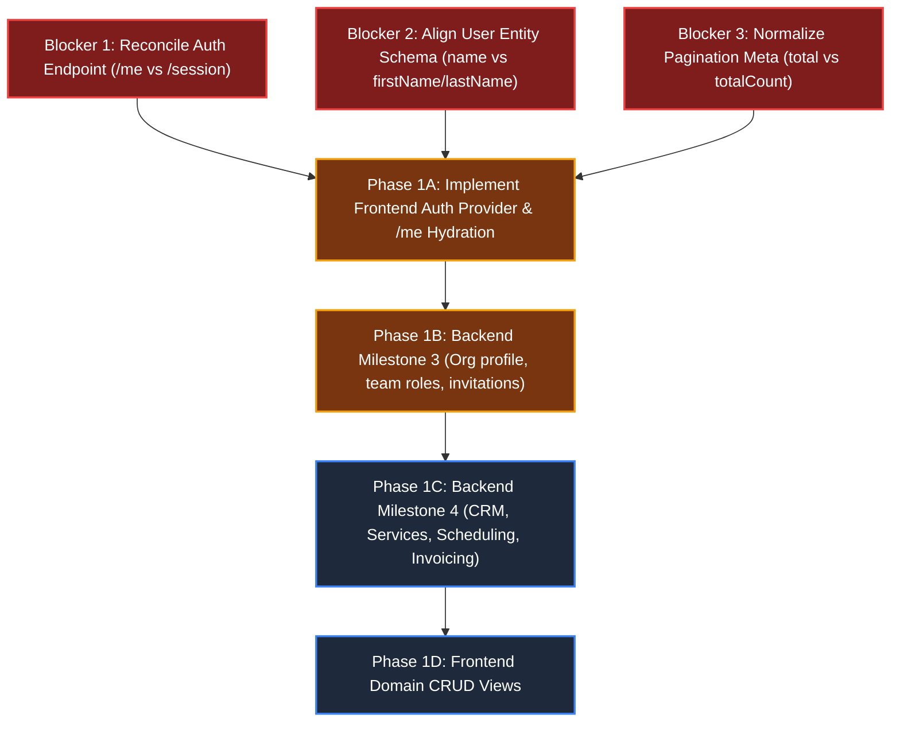

# FlowPilot — Frontend/Backend Contract Alignment & Security Audit

> **Document Version**: 1.0.0  
> **Status**: Comprehensive Alignment & Security Audit Complete  
> **Audited Repositories**: `flowpilot` (Frontend) & `flowpilot-backend` (Backend API)  
> **Source Baseline**: `MASTER-FEATURE-INVENTORY.md`, `FRONTEND-FEATURE-BLUEPRINT.md`

---

## 1. Executive Summary & Verification Methodology

A line-by-line contract alignment audit was conducted between the approved **FlowPilot Frontend Architecture** and the actual codebase of **`flowpilot-backend`**.

### Verification Summary

- **Backend Architecture Verified**: Express, Node.js LTS, PostgreSQL, Prisma 6, Argon2id, Zod, and Vitest.
- **Backend Operational Routes**: Strictly limited to `/api/v1/health` and `/api/v1/auth` (`login`, `register`, `logout`, `me`).
- **Live Database Status**: 5 tables (`users`, `organizations`, `memberships`, `sessions`, `_prisma_migrations`) verified in PostgreSQL on Supabase Pooler. 71 automated tests passing across 12 test suites, including 8 live PostgreSQL integration tests.
- **Key Finding**: While the backend authentication engine and tenant isolation middleware are production-grade and 100% verified against live PostgreSQL, **critical contract mismatches exist between frontend type assumptions and actual backend payload schemas**, and **Milestones 3 through 6 domain endpoints are completely unbuilt on the backend**.

---

## 2. High-Priority Contract Mismatches Found

The following concrete mismatches were discovered between the frontend repository expectations and the actual backend implementation. These must be reconciled before frontend integration begins.

### Mismatch 1: Auth Session Endpoint Path

- **Frontend Expectation** ([`docs/AUTHENTICATION-FRONTEND.md`](file:///c:/Users/Rakib/Desktop/Projects/Business%20Operation/flowpilot/docs/AUTHENTICATION-FRONTEND.md#L25), [`docs/IMPLEMENTATION-ROADMAP.md`](file:///c:/Users/Rakib/Desktop/Projects/Business%20Operation/flowpilot/docs/IMPLEMENTATION-ROADMAP.md#L53)):
  `GET /api/v1/auth/session`
- **Actual Backend Implementation** ([`flowpilot-backend/src/routes/v1.ts:8`](file:///c:/Users/Rakib/Desktop/Projects/Business%20Operation/flowpilot-backend/src/routes/v1.ts#L8), [`flowpilot-backend/src/modules/auth/auth.routes.ts:12`](file:///c:/Users/Rakib/Desktop/Projects/Business%20Operation/flowpilot-backend/src/modules/auth/auth.routes.ts#L12)):
  `GET /api/v1/auth/me`
- **Impact**: Frontend session hydration calling `/auth/session` will return HTTP 404 Route Not Found.
- **Resolution**: Frontend must target `GET /api/v1/auth/me`.

---

### Mismatch 2: User Entity Schema & Field Mapping

- **Frontend Expectation** ([`src/features/auth/types.ts:4-12`](file:///c:/Users/Rakib/Desktop/Projects/Business%20Operation/flowpilot/src/features/auth/types.ts#L4-L12)):
  ```ts
  export interface User {
    id: string;
    email: string;
    firstName: string;
    lastName: string;
    avatarUrl?: string | null;
    isEmailVerified: boolean;
    createdAt: string;
  }
  ```
- **Actual Backend Implementation** ([`prisma/schema.prisma:30-38`](file:///c:/Users/Rakib/Desktop/Projects/Business%20Operation/flowpilot-backend/prisma/schema.prisma#L30-L38), [`src/modules/auth/auth.controller.ts:19-23`](file:///c:/Users/Rakib/Desktop/Projects/Business%20Operation/flowpilot-backend/src/modules/auth/auth.controller.ts#L19-L23)):
  ```ts
  // Backend returns:
  user: {
    id: string;
    email: string;
    name: string; // Single combined name string!
  }
  ```
- **Impact**: Reading `user.firstName` or `user.lastName` in frontend components yields `undefined`.
- **Resolution**: Align frontend `User` interface to `{ id: string; email: string; name: string }` (or introduce computed getters in the frontend `useAuth` hook).

---

### Mismatch 3: Pagination Metadata Schema

- **Frontend Expectation** ([`src/lib/api/types.ts:3-10`](file:///c:/Users/Rakib/Desktop/Projects/Business%20Operation/flowpilot/src/lib/api/types.ts#L3-L10)):
  ```ts
  export interface PaginationMeta {
    page: number;
    limit: number;
    totalCount: number; // Expects totalCount
    totalPages: number;
    hasNextPage: boolean;
    hasPrevPage: boolean;
  }
  ```
- **Actual Backend Implementation** ([`src/common/types/index.ts:22-27`](file:///c:/Users/Rakib/Desktop/Projects/Business%20Operation/flowpilot-backend/src/common/types/index.ts#L22-L27)):
  ```ts
  export interface PaginationMeta {
    page: number;
    limit: number;
    total: number; // Backend provides total
    totalPages: number;
  }
  ```
- **Impact**: Reading `meta.totalCount` in data tables returns `undefined`, breaking pagination controls.
- **Resolution**: Normalize pagination in `flowpilot` to read `total: number` (or update backend `sendSuccess` helper to include `totalCount`, `hasNextPage`, `hasPrevPage`).

---

### Mismatch 4: Production Cookie `SameSite` Policy

- **Actual Backend Implementation** ([`src/config/security.ts:85`](file:///c:/Users/Rakib/Desktop/Projects/Business%20Operation/flowpilot-backend/src/config/security.ts#L85)):
  `sameSite: isProd ? 'strict' : 'lax'`
- **Architectural Risk**: If the production frontend is hosted on `app.flowpilot.com` and the API is hosted on `api.flowpilot.com`, `SameSite: 'strict'` can cause modern browsers to withhold credentials on cross-subdomain fetch requests.
- **Resolution**: Ensure production deployment serves frontend and API under a shared reverse proxy (e.g., `/api` rewrites on the same domain) or update backend to `sameSite: 'lax'` for cross-subdomain credentialed CORS.

---

### Mismatch 5: Missing Domain Modules in Backend

- **Audit Finding**: In `flowpilot-backend/src/routes/v1.ts`, **only** `/health` and `/auth` are mounted.
- **Missing Modules**:
  - `Organization` endpoints (`GET/PATCH /api/v1/organizations/:id`): Missing.
  - `Team` and `Invitations` (`/organizations/:id/members`, `/invitations`): Missing.
  - `Customer CRM` (`/customers`): Missing.
  - `Service Catalog` (`/services`): Missing.
  - `Appointments / Scheduling` (`/appointments`): Missing.
  - `Invoices & Payments` (`/invoices`): Missing.
  - `Dashboard Metrics` (`/dashboard/metrics`): Missing.
- **Resolution**: Frontend development must strictly sequence Phase 1A (Auth integration) first while Backend Milestone 3 (Organization and Invitations) is completed.

---

## 3. Comprehensive Feature-by-Feature Alignment Matrix

The following matrix audits all 82 cataloged features against the actual `flowpilot-backend` implementation:

| Feature ID         | Feature Name                | Expected Endpoint & Method                         | Backend Implementation Status | Contract Alignment | Backend Source Evidence                      | Required Next Action                      |
| :----------------- | :-------------------------- | :------------------------------------------------- | :---------------------------: | :----------------: | :------------------------------------------- | :---------------------------------------- |
| **`AUTH-01`**      | Email & Password Login      | `POST /api/v1/auth/login`                          |         **Available**         |    **Aligned**     | `auth.routes.ts:9`, `auth.controller.ts:8`   | Ready for frontend integration            |
| **`AUTH-02`**      | Account & Org Registration  | `POST /api/v1/auth/register`                       |         **Available**         |    **Aligned**     | `auth.routes.ts:10`, `auth.controller.ts:32` | Ready for frontend integration            |
| **`AUTH-03`**      | Session Restoration (`/me`) | `GET /api/v1/auth/me`                              |         **Available**         |    **Mismatch**    | `auth.routes.ts:12`, `auth.controller.ts:70` | Fix frontend path (`/me` not `/session`)  |
| **`AUTH-04`**      | Server-Side Logout          | `POST /api/v1/auth/logout`                         |         **Available**         |    **Aligned**     | `auth.routes.ts:11`, `auth.controller.ts:56` | Ready for frontend integration            |
| **`AUTH-05`**      | Password Reset Request      | `POST /api/v1/auth/forgot-password`                |          **Missing**          |    **Blocked**     | No route in `auth.routes.ts`                 | Backend must implement reset token        |
| **`AUTH-06`**      | Password Reset Complete     | `POST /api/v1/auth/reset-password`                 |          **Missing**          |    **Blocked**     | No route in `auth.routes.ts`                 | Backend must implement token hash         |
| **`AUTH-07`**      | Email Verification          | `POST /api/v1/auth/verify-email`                   |          **Missing**          |    **Blocked**     | Deferred to V1                               | Backend email service dependency          |
| **`AUTH-08`**      | Session Expiry Interceptor  | `401 Unauthorized` response                        |         **Available**         |    **Aligned**     | `middleware/auth.ts:19`                      | Frontend `onUnauthorized` handler         |
| **`USER-01`**      | View Personal Profile       | `GET /api/v1/auth/me`                              |         **Available**         |    **Mismatch**    | `auth.controller.ts:77-88`                   | Returns `name`, not `firstName/lastName`  |
| **`USER-02`**      | Update Personal Profile     | `PATCH /api/v1/users/me`                           |          **Missing**          |    **Blocked**     | No `users` router mounted in `v1.ts`         | Backend must add users router             |
| **`USER-03`**      | Change Password             | `POST /api/v1/users/change-password`               |          **Missing**          |    **Blocked**     | No users router mounted                      | Backend must add password change endpoint |
| **`USER-04`**      | Notification Preferences    | `PATCH /api/v1/users/preferences`                  |          **Missing**          |    **Blocked**     | No user settings model in Prisma             | Deferred to V1                            |
| **`ORG-01`**       | View Organization Profile   | `GET /api/v1/organizations/:id`                    |          **Missing**          |    **Blocked**     | `modules/organizations` has only types       | Implement in Milestone 3                  |
| **`ORG-02`**       | Update Org Settings         | `PATCH /api/v1/organizations/:id`                  |          **Missing**          |    **Blocked**     | `currency` & `timezone` not in DB schema     | Apply Milestone 3 Prisma migration        |
| **`ORG-03`**       | Create Additional Workspace | `POST /api/v1/organizations`                       |          **Missing**          |    **Blocked**     | No route in backend                          | Deferred to V1                            |
| **`ORG-04`**       | Custom Workspace Logo       | `POST /api/v1/organizations/:id/logo`              |          **Missing**          |    **Blocked**     | No storage provider                          | Deferred to V1                            |
| **`ORG-05`**       | Workspace Archival          | `DELETE /api/v1/organizations/:id`                 |          **Missing**          |    **Blocked**     | No route in backend                          | Deferred to V1                            |
| **`SWITCH-01`**    | Org Switcher UI             | `GET /api/v1/auth/me`                              |         **Available**         |    **Aligned**     | `memberships` returned in `/me`              | Ready for frontend integration            |
| **`SWITCH-02`**    | Tenant Context Header       | `X-Organization-Id: <UUID>`                        |         **Available**         |    **Aligned**     | `middleware/tenant-context.ts:20`            | Ready for frontend integration            |
| **`SWITCH-03`**    | Workspace Re-auth           | Query verification on request                      |         **Available**         |    **Aligned**     | `middleware/tenant-context.ts:46`            | Verified in PostgreSQL integration tests  |
| **`TEAM-01`**      | Team Member Directory       | `GET /api/v1/organizations/:id/members`            |          **Missing**          |    **Blocked**     | Milestone 3 scope                            | Implement in Milestone 3                  |
| **`TEAM-02`**      | Invite Member by Email      | `POST /api/v1/organizations/:id/invitations`       |          **Missing**          |    **Blocked**     | No `Invitation` model in Prisma              | Implement in Milestone 3                  |
| **`TEAM-03`**      | Accept Team Invitation      | `POST /api/v1/invitations/accept`                  |          **Missing**          |    **Blocked**     | Milestone 3 scope                            | Implement in Milestone 3                  |
| **`TEAM-04`**      | Resend / Revoke Invite      | `DELETE /api/v1/invitations/:id`                   |          **Missing**          |    **Blocked**     | Milestone 3 scope                            | Implement in Milestone 3                  |
| **`TEAM-05`**      | Update Member Role          | `PATCH /api/v1/organizations/:id/members/:userId`  |          **Missing**          |    **Blocked**     | Milestone 3 scope                            | Implement in Milestone 3                  |
| **`TEAM-06`**      | Remove Team Member          | `DELETE /api/v1/organizations/:id/members/:userId` |          **Missing**          |    **Blocked**     | Milestone 3 scope                            | Implement in Milestone 3                  |
| **`TEAM-07`**      | Role-Based UI Guards        | Client check + Server RBAC                         |         **Available**         |    **Aligned**     | `middleware/tenant-context.ts:71`            | Server RBAC fully tested                  |
| **`DASH-01`**      | KPI Metrics Cards           | `GET /api/v1/dashboard/metrics`                    |          **Missing**          |    **Blocked**     | No dashboard module in backend               | Requires CRM, Sched, Inv models           |
| **`DASH-02`**      | Today's Schedule Glance     | `GET /api/v1/appointments?date=today`              |          **Missing**          |    **Blocked**     | No appointment module                        | Depends on Milestone 4                    |
| **`DASH-03`**      | Activity Feed Queue         | `GET /api/v1/activity-feed`                        |          **Missing**          |    **Blocked**     | No activity feed model                       | Depends on Milestone 4                    |
| **`DASH-04`**      | Multi-State UI States       | Frontend Design System                             |         **Available**         |    **Aligned**     | `src/components/feedback/*`                  | Fully implemented in frontend             |
| **`CRM-01..07`**   | Customer CRM Domain         | `GET/POST/PATCH/DELETE /api/v1/customers`          |          **Missing**          |    **Blocked**     | No `Customer` table in Prisma                | Milestone 4 scope                         |
| **`SERV-01..07`**  | Service Catalog Domain      | `GET/POST/PATCH /api/v1/services`                  |          **Missing**          |    **Blocked**     | No `Service` table in Prisma                 | Milestone 4 scope                         |
| **`SCHED-01..08`** | Scheduling Domain           | `GET/POST/PATCH /api/v1/appointments`              |          **Missing**          |    **Blocked**     | No `Appointment` table in Prisma             | Milestone 4 scope                         |
| **`INV-01..08`**   | Invoices & Payments         | `GET/POST /api/v1/invoices`                        |          **Missing**          |    **Blocked**     | No `Invoice` table in Prisma                 | Milestone 4 scope                         |
| **`NOTIF-01..04`** | Notifications Domain        | `GET /api/v1/notifications`                        |          **Missing**          |    **Blocked**     | No notification system                       | Milestone 5 scope                         |
| **`ANLYT-01..04`** | Reporting & Analytics       | `GET /api/v1/reports/*`                            |          **Missing**          |    **Blocked**     | No reporting endpoints                       | Milestone 6 scope                         |
| **`BILL-01..04`**  | SaaS Platform Billing       | `GET/POST /api/v1/billing/*`                       |          **Missing**          |    **Blocked**     | No Stripe integration                        | Milestone 6 scope                         |
| **`ADMIN-01`**     | Cross-Tenant System Health  | `GET /api/v1/health/ready`                         |         **Available**         |    **Aligned**     | `health.controller.ts:18`                    | Verified with live DB ping                |
| **`ADMIN-02`**     | Security Audit Logging      | Internal backend log                               |          **Partial**          |    **Aligned**     | Pino logger active, no DB model              | Backend logging active                    |
| **`ADMIN-03`**     | Platform Tenant Console     | `GET /api/v1/admin/organizations`                  |          **Missing**          |    **Blocked**     | Superadmin role required                     | Deferred to V1                            |
| **`EXP-01..06`**   | Future Expansion            | Portal, Tasks, Files, Webhooks                     |          **Missing**          |    **Blocked**     | Future scope                                 | Deferred to Future                        |

---

## 4. Security & Tenant Isolation Audit

### 4.1 Cross-Tenant Data Isolation (IDOR Prevention)

- **Backend Audit**: Inspected [`tenantContextMiddleware`](file:///c:/Users/Rakib/Desktop/Projects/Business%20Operation/flowpilot-backend/src/common/middleware/tenant-context.ts#L46-L68).
- **Finding**: **SECURE & VERIFIED AGAINST POSTGRESQL**.
  When a user supplies an `X-Organization-Id` header:
  1. The middleware checks if the user's session includes membership in that organization.
  2. If not pre-hydrated, it queries PostgreSQL:
     ```ts
     await prisma.membership.findUnique({
       where: { userId_organizationId: { userId: req.user.id, organizationId } },
     });
     ```
  3. If no membership exists, it returns `HTTP 403 Forbidden` (`code: 'FORBIDDEN'`, message: _"You do not have access to this organization"_).
- **Live Test Evidence**: Verified in [`tests/integration/postgres-auth.test.ts:287-302`](file:///c:/Users/Rakib/Desktop/Projects/Business%20Operation/flowpilot-backend/tests/integration/postgres-auth.test.ts#L287-L302) where user Bob attempting to query user Alice's organization is intercepted and blocked with HTTP 403.

---

### 4.2 Cryptographic Session & Token Handling

- **Backend Audit**: Inspected [`crypto.ts`](file:///c:/Users/Rakib/Desktop/Projects/Business%20Operation/flowpilot-backend/src/modules/auth/crypto.ts) and [`auth.service.ts`](file:///c:/Users/Rakib/Desktop/Projects/Business%20Operation/flowpilot-backend/src/modules/auth/auth.service.ts).
- **Finding**: **SECURE**.
  - Passwords are encrypted using **Argon2id** (`memoryCost: 65536`, `timeCost: 3`, `parallelism: 4`).
  - Session tokens are generated using 256-bit random bytes (`crypto.randomBytes(32).toString('hex')`).
  - **Zero Raw Tokens in Database**: Only the SHA-256 hash (`crypto.createHash('sha256').update(rawToken).digest('hex')`) is persisted in PostgreSQL.
  - Server-side logout actively purges the session row from `sessions` table (verified in test step 3.4).

---

### 4.3 Rate Limiting & Brute-Force Defense

- **Backend Audit**: Inspected [`security.ts`](file:///c:/Users/Rakib/Desktop/Projects/Business%20Operation/flowpilot-backend/src/config/security.ts#L63-L78) and [`app.ts`](file:///c:/Users/Rakib/Desktop/Projects/Business%20Operation/flowpilot-backend/src/app.ts#L47-L51).
- **Finding**: **SECURE**.
  - General API: 100 requests per 15 minutes.
  - Dedicated Auth Rate Limiter: Strictly limits `/api/v1/auth/login` and `/api/v1/auth/register` to **15 attempts per 15 minutes per IP address** (`StandardHeaders: 'draft-7'`).

---

### 4.4 CORS & Cookie Credential Assumptions

- **Backend Audit**: Inspected [`security.ts`](file:///c:/Users/Rakib/Desktop/Projects/Business%20Operation/flowpilot-backend/src/config/security.ts#L17-L44).
- **Finding**: **SECURE WITH OPERATIONAL RISK**.
  - Wildcard `*` origins are strictly prohibited with an explicit exception throw:
    `Wildcard '*' origin is not permitted with credentialed CORS requests`.
  - Allowed headers include `Content-Type`, `Authorization`, `X-Request-Id`, `X-Organization-Id`.
  - _Operational Risk_: If `CORS_ORIGIN` in `.env` is not set to the exact frontend origin (e.g. `http://localhost:3000` in local dev), browser requests will be blocked with CORS errors. Ensure `.env` specifies the full origin without trailing slash.

---

## 5. Prioritized Blocker & Remediation Roadmap



### Action Items Before Implementation Can Safely Proceed

#### Step 1: Frontend Type Reconciliation (Immediate)

1. Update [`src/features/auth/types.ts`](file:///c:/Users/Rakib/Desktop/Projects/Business%20Operation/flowpilot/src/features/auth/types.ts) to define `User` as `{ id: string; email: string; name: string }` matching PostgreSQL and `flowpilot-backend`.
2. Update [`src/lib/api/types.ts`](file:///c:/Users/Rakib/Desktop/Projects/Business%20Operation/flowpilot/src/lib/api/types.ts) `PaginationMeta` to define `total: number` matching the backend contract.
3. Ensure all frontend auth references call `/api/v1/auth/me`.

#### Step 2: Phase 1A Frontend Auth Integration

- Wire [`src/app/(auth)/login/page.tsx`](<file:///c:/Users/Rakib/Desktop/Projects/Business%20Operation/flowpilot/src/app/(auth)/login/page.tsx>) and [`src/app/(auth)/register/page.tsx`](<file:///c:/Users/Rakib/Desktop/Projects/Business%20Operation/flowpilot/src/app/(auth)/register/page.tsx>) to real endpoints (`/api/v1/auth/login`, `/api/v1/auth/register`).
- Implement `AuthProvider` with `/api/v1/auth/me` session hydration.
- Wire `OrgSwitcher` to populate from `session.memberships` and set `X-Organization-Id`.

#### Step 3: Backend Milestone 3 Execution

- Apply non-destructive Prisma migration for `currency`, `timezone`, and `Invitation` model.
- Implement `/api/v1/organizations/:id` and `/api/v1/organizations/:id/members` endpoints.
- Unblocks Frontend Team Management (`TEAM-01` to `TEAM-06`) and Organization Settings (`ORG-01` to `ORG-02`).
