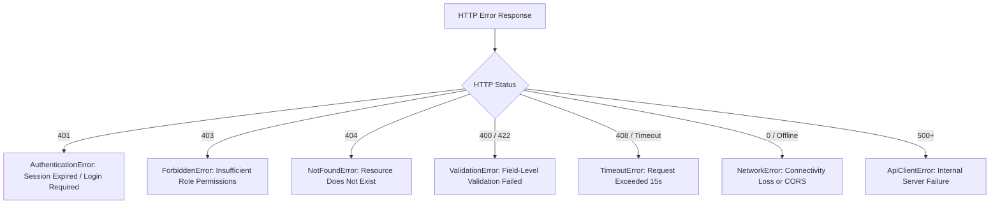

# FlowPilot — Frontend-to-Backend API Integration Specification

> **Document Version**: 1.0.0  
> **Status**: Approved Integration Boundary  
> **Backend Service**: `flowpilot-backend` (Express REST API)  
> **Communication Protocol**: HTTP/1.1 & HTTP/2 JSON REST over TLS

---

## 1. Centralized API Configuration

All communication between `flowpilot` and `flowpilot-backend` is routed through the centralized typed `ApiClient` configured in `src/lib/api/client.ts`.

### Configuration Variables

- `NEXT_PUBLIC_API_BASE_URL`: Base REST API endpoint (e.g., `http://localhost:5000/api/v1` in development, `https://api.flowpilot.app/api/v1` in production).
- `NEXT_PUBLIC_API_TIMEOUT_MS`: Maximum duration in milliseconds before a request is aborted (default: `15000` ms).

Raw `fetch()` calls scattered across components or hooks are **strictly prohibited**.

---

## 2. Standardized Request & Response Envelope

### Standard Request Headers

```http
Accept: application/json
Content-Type: application/json
X-Organization-Id: org_01j7... (injected when inside workspace context)
```

### Success Response Contract (`ApiResponse<T>`)

Every successful JSON response from `flowpilot-backend` must adhere to this structure:

```json
{
  "success": true,
  "data": {
    "id": "cust_01j7...",
    "name": "Acme Landscaping",
    "email": "contact@acme.com"
  },
  "message": "Customer record retrieved successfully",
  "meta": {
    "page": 1,
    "limit": 25,
    "totalCount": 142,
    "totalPages": 6,
    "hasNextPage": true,
    "hasPrevPage": false
  }
}
```

### Error Response Contract (`ApiErrorResponse`)

All 4xx and 5xx errors from the backend must follow this normalized error schema:

```json
{
  "success": false,
  "error": {
    "code": "VALIDATION_ERROR",
    "message": "The provided customer payload failed validation.",
    "status": 422,
    "details": {
      "email": ["Email address is already registered"],
      "phone": ["Phone number must include international country code"]
    }
  }
}
```

---

## 3. Error Normalization & Client Error Classes

When an error occurs, `ApiClient` maps HTTP response codes to structured Error instances:



### Form Validation Error Mapping

When a `ValidationError` is thrown, the client maps `details` directly to React Hook Form field errors using `setError`:

```ts
if (error instanceof ValidationError && error.details) {
  Object.entries(error.details).forEach(([field, messages]) => {
    form.setError(field as Path<FormValues>, {
      type: "server",
      message: messages[0],
    });
  });
}
```

---

## 4. TanStack Query Conventions

FlowPilot uses TanStack Query v5 to interact with the backend API:

### Query Key Factory Pattern (`src/lib/api/query-keys.ts`)

```ts
export const queryKeys = {
  customers: {
    all: ["customers"] as const,
    list: (filters?: Record<string, unknown>) =>
      [...queryKeys.customers.all, "list", filters ?? {}] as const,
    detail: (id: string) => [...queryKeys.customers.all, "detail", id] as const,
  },
};
```

### Query Guidelines

1. **Stale Time**: 2 minutes (`1000 * 60 * 2`). Rapid page switches within 2 minutes return instant cached data without repeating network requests.
2. **Garbage Collection Time**: 10 minutes (`1000 * 60 * 10`).
3. **Retry Strategy**:
   - Status 400, 401, 403, 404, 422: **0 retries** (client error will not resolve on immediate retry).
   - Network failure or 500 error: **2 retries** with exponential backoff.
4. **Session Sensitivity**:
   - Invoking `clearSessionCache()` empties the query cache on logout or tenant switch, preventing cross-organization data leakage.

---

## 5. Decisions Coordinated with `flowpilot-backend`

The following interface contracts must be finalized with the backend team:

| Area                       | Frontend Architectural Assumption                         | Backend Decision Required                          |
| :------------------------- | :-------------------------------------------------------- | :------------------------------------------------- |
| **Authentication Session** | Secure HTTP-only cookies (`credentials: "include"`)       | Cookie name, SameSite policy, domain configuration |
| **Tenant Identification**  | `X-Organization-Id` HTTP header                           | Header acceptance & JWT tenant claims alignment    |
| **OpenAPI Contract**       | Future typed API client generation from OpenAPI spec      | Backend generation of `/docs/openapi.json`         |
| **CORS Configuration**     | Backend allowlists `NEXT_PUBLIC_APP_URL` with credentials | Express CORS middleware configuration              |
