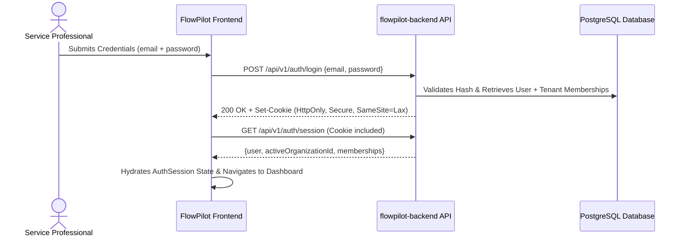

# FlowPilot — Frontend Authentication & Multi-Tenancy Architecture

> **Document Version**: 1.0.0  
> **Status**: Approved Security & Integration Baseline  
> **Model**: Multi-Tenant Workspace Organization Membership  
> **Target Authority**: Backend Authorization (`flowpilot-backend`)

---

## 1. Authentication Strategy & Threat Model

FlowPilot adopts a security-first stance on authentication storage and session management:



### Cookie-First vs. LocalStorage Security Trade-Offs

| Evaluation Vector     | HTTP-Only Cookies (Recommended Architecture)                            | LocalStorage Bearer Tokens (Rejected Architecture)                                             |
| :-------------------- | :---------------------------------------------------------------------- | :--------------------------------------------------------------------------------------------- |
| **XSS Vulnerability** | **Protected**: JavaScript cannot access or read session tokens.         | **Severe Risk**: Any third-party script or XSS bug can exfiltrate tokens.                      |
| **CSRF Mitigation**   | Mitigated via `SameSite=Lax` + custom `X-Organization-Id` / CSRF token. | Immune to CSRF, but vulnerable to complete account takeover via XSS.                           |
| **Hydration on SSR**  | Next.js Server Components can inspect cookie on initial render.         | Server cannot access `localStorage`; causes layout shift and flash of unauthenticated content. |
| **Logout Revocation** | Server issues expired cookie header; instantly revokes session.         | Client can delete key, but token remains valid until expiry unless blacklisted.                |

**Architectural Rule**: FlowPilot prioritizes HTTP-only cookies managed by `flowpilot-backend`. No access tokens are stored in `localStorage` or `sessionStorage`.

---

## 2. Multi-Tenant Organization Membership Model

A single FlowPilot user account can belong to multiple organizations (e.g. an agency contractor managing multiple client accounts or a business owner operating two service branches).

### Membership Roles & Permissions

```ts
export type WorkspaceRole = "OWNER" | "ADMIN" | "MEMBER" | "BILLING";
```

| Role          | Operational Scope        | UI Affordances                                                                  |
| :------------ | :----------------------- | :------------------------------------------------------------------------------ |
| **`OWNER`**   | Full workspace authority | Organization deletion, billing subscriptions, role assignment, all operations   |
| **`ADMIN`**   | Workspace management     | Team member invitations, service catalog configuration, customer CRM, invoicing |
| **`MEMBER`**  | Service execution        | View assigned appointments, record customer notes, log service hours            |
| **`BILLING`** | Financial administration | View and issue invoices, view payment receipts, update payment methods          |

---

## 3. The "UI Affordance vs. Backend Authority" Tenet

> ⚠️ **CRITICAL SECURITY REQUIREMENT**:  
> Client-side role checks (such as disabling a "Delete Workspace" button or hiding an "Invite Member" menu) are **strictly user experience affordances**, never security boundaries.

1. **The Backend Is the Sole Authority**: Every sensitive mutation received by `flowpilot-backend` validates the session token, verifies the user's role in the organization requested via `X-Organization-Id`, and rejects unauthorized requests with a `403 Forbidden`.
2. **Never Trust Client State**: The frontend will never assume a user is authorized based on client-side state manipulation.
3. **Strict Isolation of Platform Administration**: Superadmin platform features (e.g., viewing cross-tenant database metrics or managing system health) must never be embedded inside regular workspace dashboard routes. Platform administration belongs in a segregated, isolated domain.

---

## 4. Session Expiration & Re-Authentication Flow

When an API call returns `401 Unauthorized` (e.g., after session timeout):

1. `ApiClient` intercepts the 401 status.
2. Triggers `onUnauthorized` callback registered in `src/lib/api/client.ts`.
3. Calls `clearSessionCache()` to purge cached client data.
4. Redirects browser to `/login?returnUrl=${encodeURIComponent(currentPath)}` with a notice that the session has expired.
