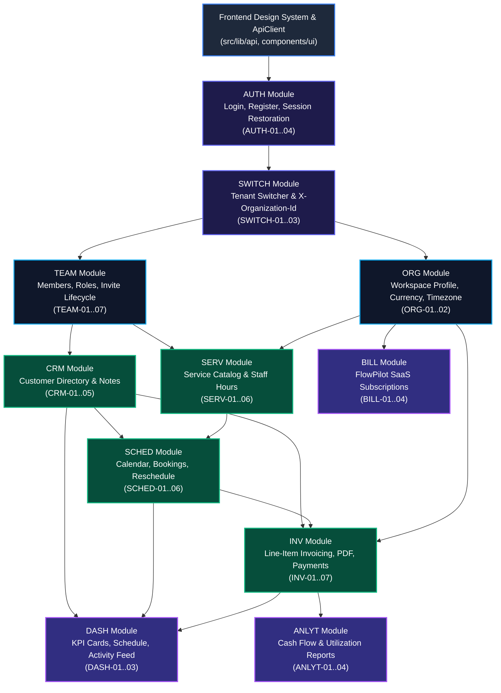

# FlowPilot — Feature Dependency Map & Critical Path

> **Document Version**: 1.0.0  
> **Status**: Technical Dependency Specification  
> **Purpose**: Sequence execution without circular dependencies or blocked engineering streams

---

## 1. System-Wide Feature Dependency Graph

The following topological map illustrates the strict progression of technical and domain prerequisites across FlowPilot:



---

## 2. Module Prerequisite Matrix

The table below outlines the exact preconditions required before each feature module can be safely implemented and tested:

| Target Module                              | Functional Prerequisites                            | Database / Backend Prerequisites                                      | Frontend Prerequisites                                               |
| :----------------------------------------- | :-------------------------------------------------- | :-------------------------------------------------------------------- | :------------------------------------------------------------------- |
| **Authentication (`AUTH`)**                | Live PostgreSQL database connection, CORS allowlist | `/auth/login`, `/auth/register`, `/auth/me`, `/auth/logout` endpoints | `src/lib/api/client.ts`, Form components (`Input`, `Button`, `Card`) |
| **Tenant Switching (`SWITCH`)**            | `AUTH-01`, `AUTH-03`                                | User memberships array populated on session payload                   | `ApiClient.setOrganizationId()`, Dropdown menu primitive             |
| **Organization Settings (`ORG`)**          | `SWITCH-02`, `SWITCH-03`                            | `Organization` model (`name`, `currency`, `timezone`)                 | Settings layout, Zod validation for currency & timezone              |
| **Team Management (`TEAM`)**               | `ORG-01`, `SWITCH-02`                               | `Invitation` model, `/organizations/:id/members`, token hashing       | Modal dialog primitive, table primitive, invite form                 |
| **Customer CRM (`CRM`)**                   | `SWITCH-02`, `TEAM-07`                              | `Customer` model with `organizationId` foreign key and indexes        | Data table with pagination, search bar, empty/loading states         |
| **Services & Staff Availability (`SERV`)** | `ORG-01` (Currency), `TEAM-01` (Staff list)         | `Service`, `StaffAvailability` models                                 | Duration picker, currency input, weekly shift scheduler grid         |
| **Appointments & Scheduling (`SCHED`)**    | `CRM-01`, `SERV-01`, `SERV-06`                      | `Appointment` model with collision detection query                    | Interactive calendar view (grid layout), booking modal               |
| **Invoicing & Manual Payments (`INV`)**    | `CRM-01`, `ORG-01` (Currency), `SCHED-06`           | `Invoice`, `InvoiceLineItem`, `Payment` models                        | Line-item editor, tax calculator, printable invoice view             |
| **Workspace Dashboard (`DASH`)**           | `CRM-01`, `SCHED-01`, `INV-01`                      | Summary aggregate endpoints (`/dashboard/metrics`)                    | Metric card primitives, skeleton states, activity feed list          |
| **Platform SaaS Billing (`BILL`)**         | `ORG-01`                                            | Stripe Customer & Subscription webhook integration                    | Pricing table, Stripe portal redirect action                         |

---

## 3. The Critical Path to MVP Delivery

The critical path represents the longest chain of dependent activities that dictates the minimum delivery timeline:

```
[Phase 1A: Auth & Tenant Context]
  ├── Integrate /auth/login & /auth/register with real session cookie
  ├── Build /me session bootstrapper & auth context provider
  └── Implement Organization Switcher in dashboard header
            │
            ▼
[Phase 1B: Organization & Team Roles (Milestone 3)]
  ├── Apply Prisma migration for Organization currency/timezone & Invitations
  ├── Build Team Member directory & invite modal
  └── Enforce RBAC permission guards on client routes
            │
            ▼
[Phase 1C: Foundational Catalogues (Milestone 4A)]
  ├── Customer CRM schema, API, and directory UI
  └── Service Catalog schema, API, and staff availability grid
            │
            ▼
[Phase 1D: Operational Scheduling (Milestone 4B)]
  ├── Calendar views (Day, Week, Month)
  ├── Double-booking conflict check logic
  └── Appointment booking & status lifecycle
            │
            ▼
[Phase 1E: Invoicing & Cash Reconciliation (Milestone 4C)]
  ├── Line-item invoice builder
  ├── Convert completed appointment to invoice
  └── Manual payment logging (Cash/Bank)
            │
            ▼
[Phase 1F: Dashboard Integration & Polish]
  ├── Connect real metrics to Dashboard KPI cards
  └── Wire up Today's Schedule and recent activity feed
```

---

## 4. Blocker Risks & External Dependencies

| Dependency                           | Impacted Features                                           | Blocker Risk                                                                                    | Mitigation / Recommended Solution                                                                                                                                                                  |
| :----------------------------------- | :---------------------------------------------------------- | :---------------------------------------------------------------------------------------------- | :------------------------------------------------------------------------------------------------------------------------------------------------------------------------------------------------- |
| **Transactional Email Service**      | `TEAM-02` (Invites), `AUTH-05` (Password reset), `NOTIF-02` | High: Team members cannot receive invite links without email dispatch.                          | Implement an abstract `EmailService` interface with a local development logger driver. In production, connect Resend or AWS SES.                                                                   |
| **Timezone & Locale Handling**       | `SCHED-01`, `SCHED-02`, `SERV-06`, `ORG-01`                 | Medium: Time zone drift between staff, customers, and server causes missed appointments.        | Store all timestamps in UTC (`TIMESTAMPTZ` / ISO 8601). Display in user/organization timezone using browser `Intl.DateTimeFormat`.                                                                 |
| **PDF Generation Engine**            | `INV-03` (Invoice PDF Preview)                              | Medium: Server-side PDF generation (e.g. Puppeteer) is heavy and prone to memory exhaustion.    | Use modern CSS Print stylesheets (`@media print`) and native browser print dialog for MVP; evaluate lightweight client-side PDF renderer (`@react-pdf/renderer`) if offline download is mandatory. |
| **Stripe Billing Integration**       | `BILL-01` to `BILL-04` (SaaS Subscriptions)                 | Low for MVP: Unblocks platform monetization, but not required for tenant day-to-day operations. | Defer hard payment enforcement to V1. Provide generous free trial / un-metered access during initial tenant beta.                                                                                  |
| **Database Concurrency on Bookings** | `SCHED-02`, `SCHED-04` (Double-booking prevention)          | High: Two staff booking the same room/slot simultaneously causes schedule conflicts.            | Enforce PostgreSQL transaction isolation or database-level exclusion constraint (`EXCLUDE USING gist`) on overlapping timeranges.                                                                  |
