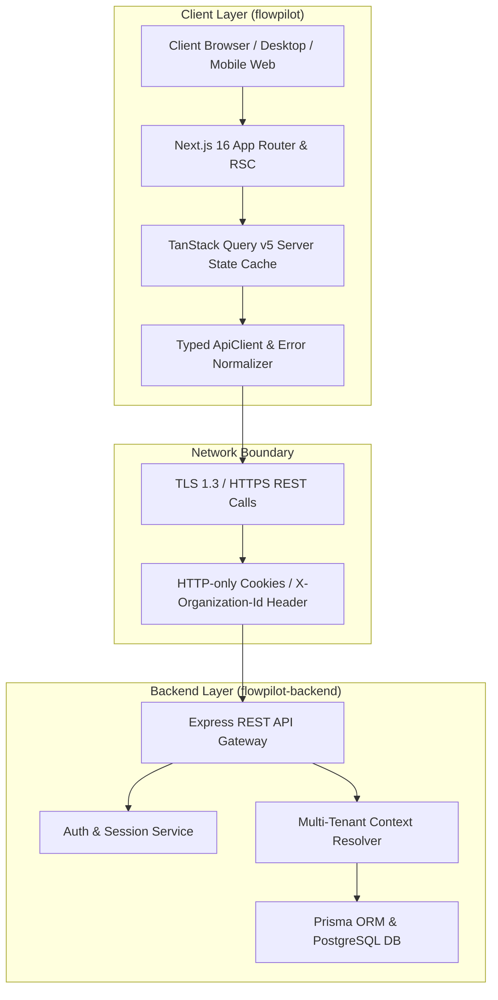
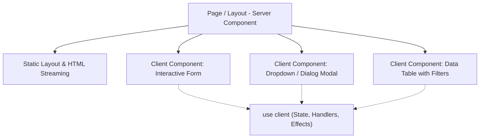

# FlowPilot — Frontend Architecture Specification

> **Document Version**: 1.0.0  
> **Status**: Approved Architectural Baseline  
> **Target System**: Next.js App Router (React 19, TypeScript Strict, Tailwind CSS v4)  
> **Backend Boundary**: Decoupled Express REST API (`flowpilot-backend`)

---

## 1. Executive Summary & Vision

**FlowPilot** is a multi-tenant Business Operations SaaS engineered with a single core value proposition:

> _"One workspace to run a service business."_

FlowPilot unifies client relationship management (CRM), appointment scheduling, team coordination, invoicing, and payment reconciliation into a coherent operational workspace.

This repository (`flowpilot`) contains solely the frontend application layer. It is architected for strict separation of concerns, enterprise-grade type safety, predictable multi-tenant data boundaries, and performance optimization before any product business features are built.

---

## 2. System Topology & Repository Boundaries

FlowPilot enforces a hard structural boundary between presentation/client logic and backend domain persistence:



### Architectural Tenets of the Boundary

1. **Zero Backend Coupling in Repository**: No Express routes, Prisma clients, or database migrations reside in `flowpilot`.
2. **Contract-Driven Communication**: All communication occurs over JSON REST endpoints exposed at `NEXT_PUBLIC_API_BASE_URL`.
3. **No Direct Database Access**: Server Components in Next.js never connect to the PostgreSQL database directly; all data requests flow through the API client.
4. **Independent Deployment**: Frontend and backend can be versioned, deployed, and scaled independently.

---

## 3. Directory Structure & Modular Responsibilities

The codebase follows a domain-driven feature layout combined with Next.js App Router conventions:

```
flowpilot/
├── .github/
│   └── workflows/
│       └── ci.yml               # Automated CI quality and build pipeline
├── docs/                        # Complete architectural specifications
│   ├── FRONTEND-ARCHITECTURE.md
│   ├── DESIGN-SYSTEM.md
│   ├── UI-UX-SPECIFICATION.md
│   ├── API-INTEGRATION.md
│   ├── AUTHENTICATION-FRONTEND.md
│   ├── ACCESSIBILITY.md
│   ├── TESTING-STRATEGY.md
│   ├── CODE-STANDARDS.md
│   ├── ARCHITECTURE-DECISIONS.md
│   └── IMPLEMENTATION-ROADMAP.md
├── public/                      # Static assets, favicon, brand SVGs
├── src/
│   ├── app/                     # Next.js App Router route groups & root handlers
│   │   ├── (public)/            # Public marketing & informational routes
│   │   │   ├── layout.tsx
│   │   │   └── page.tsx         # Foundation overview & verification
│   │   ├── (auth)/              # Authentication route group
│   │   │   ├── layout.tsx
│   │   │   └── login/page.tsx   # Verified validation login shell
│   │   ├── (dashboard)/         # Authenticated multi-tenant workspace shell
│   │   │   ├── layout.tsx       # Sidebar, workspace switcher, and topbar
│   │   │   └── dashboard/page.tsx
│   │   ├── globals.css          # Tailwind CSS v4 @theme and CSS variables
│   │   ├── layout.tsx           # Root HTML, viewport, skip-link, providers
│   │   ├── loading.tsx          # Global loading fallback
│   │   ├── error.tsx            # Route-level error boundary
│   │   ├── not-found.tsx        # 404 handler
│   │   └── global-error.tsx     # Critical root failure boundary
│   ├── components/
│   │   ├── ui/                  # Design system primitives (Button, Input, Card, etc.)
│   │   ├── feedback/            # Feedback states (EmptyState, ErrorState, LoadingState)
│   │   ├── layout/              # Structural components (Container, PageHeader)
│   │   └── providers/           # Context providers (QueryProvider)
│   ├── features/                # Domain-specific business logic & types
│   │   ├── auth/                # Session models, credentials types
│   │   ├── organizations/       # Workspace models, membership roles
│   │   ├── customers/           # CRM domain contracts (future)
│   │   ├── services/            # Catalog domain contracts (future)
│   │   ├── appointments/        # Scheduling domain contracts (future)
│   │   └── invoices/            # Billing domain contracts (future)
│   ├── lib/
│   │   ├── api/                 # Typed ApiClient, error models, TanStack client
│   │   ├── config/              # Zod-validated environment configuration
│   │   └── utils/               # Helper utilities (cn, formatting)
│   └── types/                   # Shared cross-cutting frontend TypeScript types
├── tests/
│   ├── setup.ts                 # Vitest test setup with @testing-library/jest-dom
│   ├── unit/                    # Framework level unit tests
│   └── e2e/                     # Playwright browser E2E tests
├── .editorconfig                # Universal indentation and charset conventions
├── .env.example                 # Documented template of required environment variables
├── .gitignore                   # Comprehensive ignore rules
├── .prettierrc.json             # Code formatting configuration
├── .prettierignore              # Formatting exclude rules
├── eslint.config.mjs            # Flat ESLint 9 configuration with Next.js & TS rules
├── next.config.ts               # Next.js 16 configuration with Turbopack rules
├── package.json                 # Dependency manifests & development scripts
├── tsconfig.json                # Strict TypeScript compiler options
└── vitest.config.mts            # Vitest unit test runner configuration
```

---

## 4. Server Components vs. Client Components Strategy

FlowPilot strictly leverages React Server Components (RSC) by default and isolates Client Components to interaction leaves.



### Decision Matrix

| Criterion         | React Server Component (Default)                 | Client Component (`use client`)                            |
| :---------------- | :----------------------------------------------- | :--------------------------------------------------------- |
| **Data Fetching** | Initial page metadata, static layout structuring | Dynamic mutations, real-time refetching via TanStack Query |
| **Interactivity** | None (renders HTML to client)                    | Form inputs, event listeners (`onClick`, `onChange`)       |
| **Browser APIs**  | Not available                                    | `window`, `localStorage`, `navigator`, `ResizeObserver`    |
| **React Hooks**   | Not permitted                                    | `useState`, `useEffect`, `useForm`, `useQuery`             |
| **Bundle Impact** | Zero JavaScript added to client bundle           | Adds JS bundle payload; must be kept lean                  |

---

## 5. State Management Hierarchy

FlowPilot maintains a strict separation between **Server State** and **Local UI State**, avoiding bloated global stores:

1. **Server State (TanStack Query v5)**:
   - Manages asynchronous remote data, caching, deduplication, background revalidation, and mutation states.
   - Cache keys are organized hierarchically via `queryKeys` factories in `src/lib/api/query-keys.ts`.
   - On logout or tenant switch, `clearSessionCache()` explicitly purges all cached tenant records.

2. **Local UI State (React `useState`, `useReducer`)**:
   - Manages modal visibility, dropdown toggles, active tabs, and temporary form field dirty states.
   - Kept local to the relevant component leaf.

3. **URL State (Search Params)**:
   - Table pagination, sorting, search queries, and filter parameters live in the browser URL query string.
   - This ensures deep-linking, browser history navigation (`Back`/`Forward`), and shareable operational views.

4. **Global Client State Policy**:
   - Do **NOT** install Redux, MobX, or multiple competing state stores.
   - If complex global client state emerges during later milestones (e.g. multi-step booking workflows), evaluate a minimal Zustand store with documented justification.

---

## 6. Security & Isolation Architecture

1. **Strict Context Isolation**:
   - Every API call transmits `X-Organization-Id` to enforce tenant boundary checks on the backend.
   - The frontend never treats client-side role checks as real security; all mutations and authorized views are strictly validated by the backend.

2. **Credential Hygiene**:
   - Session authentication is designed for `credentials: "include"` utilizing secure, HTTP-only, `SameSite=Lax` cookies.
   - Sensitive access tokens are never placed into `localStorage` where they are vulnerable to XSS exfiltration.

3. **Untrusted Content Sanitization**:
   - No direct usage of `dangerouslySetInnerHTML`.
   - Any external user-generated content (notes, descriptions) is rendered as text content.

4. **Environment Secret Protection**:
   - Only variables prefixed with `NEXT_PUBLIC_` are bundled to the browser.
   - Validated via Zod in `src/lib/config/env.ts` on build and runtime initialization.
