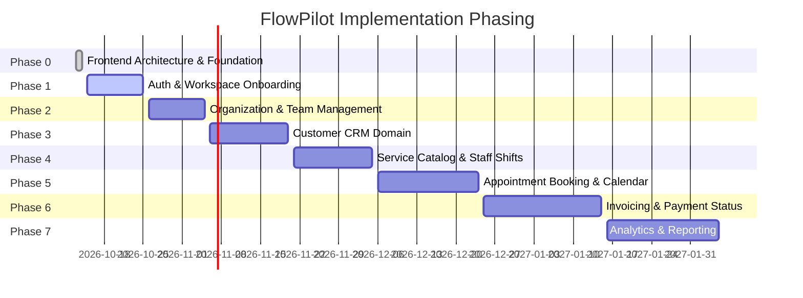

# FlowPilot — Implementation Roadmap

> **Document Version**: 1.0.0  
> **Status**: Approved Implementation Sequencing  
> **Target Delivery**: Progressive Milestone Execution

---

## Roadmap Overview

---

## Milestone Breakdown

### Phase 0: Frontend Architecture & Foundation (Current Milestone — COMPLETED)

- [x] Workspace audit, toolchain verification (Node 24, npm 11, Next.js 16, React 19).
- [x] Tailwind CSS v4 design token configuration (`src/app/globals.css`).
- [x] Accessible UI primitives library (`Button`, `Input`, `Dialog`, `Card`, `Table`, etc.).
- [x] Standard feedback components (`EmptyState`, `ErrorState`, `LoadingState`).
- [x] Decoupled `ApiClient` HTTP wrapper with normalized error models.
- [x] TanStack Query client & cache lifecycle setup.
- [x] Vitest, Testing Library, and Playwright configuration.
- [x] Complete architectural specifications in `/docs/`.

---

### Phase 1: Authentication & Workspace Onboarding (Next Recommended Milestone)

- **Goal**: Full authentication flow against `flowpilot-backend`.
- **Prerequisites**: `flowpilot-backend` auth endpoints operational (`/auth/login`, `/auth/register`, `/auth/session`, `/auth/logout`).
- **Deliverables**:
  - Sign-in page with error mapping.
  - Multi-step registration & organization creation flow.
  - Session restoration and route protection middleware.
  - Organization switcher component in dashboard sidebar.

---

### Phase 2: Organization Settings & Team Members

- **Goal**: Team collaboration and multi-tenant access control.
- **Deliverables**:
  - Team member invitation modal (`ADMIN` / `OWNER` role only).
  - Member list table with role management (`OWNER`, `ADMIN`, `MEMBER`, `BILLING`).
  - Organization profile settings (business name, currency, timezone, logo upload).

---

### Phase 3: Customer CRM Domain

- **Goal**: Service business client database.
- **Deliverables**:
  - Paginated customer directory with search and status filters.
  - Customer profile drawer/page with contact details, tags, and service history.
  - Customer creation & edit form with validation.

---

### Phase 4: Service Catalog & Staff Availability

- **Goal**: Configurable services and scheduling rules.
- **Deliverables**:
  - Service catalog management (service name, description, duration, pricing).
  - Staff assignment to services.
  - Weekly working hours and availability calendar configuration.

---

### Phase 5: Appointment Booking & Scheduling

- **Goal**: Operational calendar and appointment booking.
- **Deliverables**:
  - Day, week, and month calendar views.
  - Appointment creation modal with conflict detection.
  - Appointment status management (Scheduled, Confirmed, Completed, Cancelled).

---

### Phase 6: Invoicing & Payment Reconciliation

- **Goal**: Cash flow management and invoicing.
- **Deliverables**:
  - Invoice builder with line items, tax calculation, and discounts.
  - Invoice PDF preview.
  - Payment status recording (Draft, Issued, Paid, Overdue, Void).

---

### Phase 7: Analytics & Reporting

- **Goal**: Business intelligence for service business owners.
- **Deliverables**:
  - Operational dashboard metrics (revenue, appointment volume, customer growth).
  - Date-range filtering and trend visualizations.
