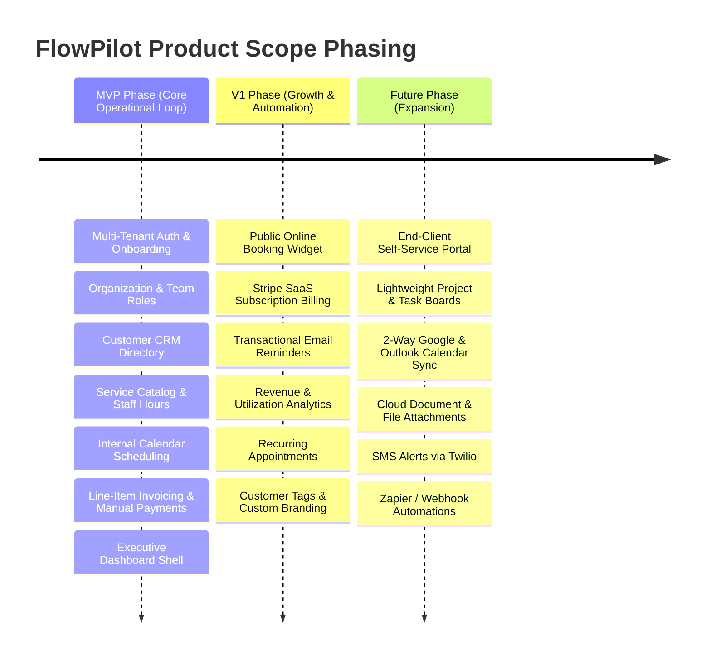
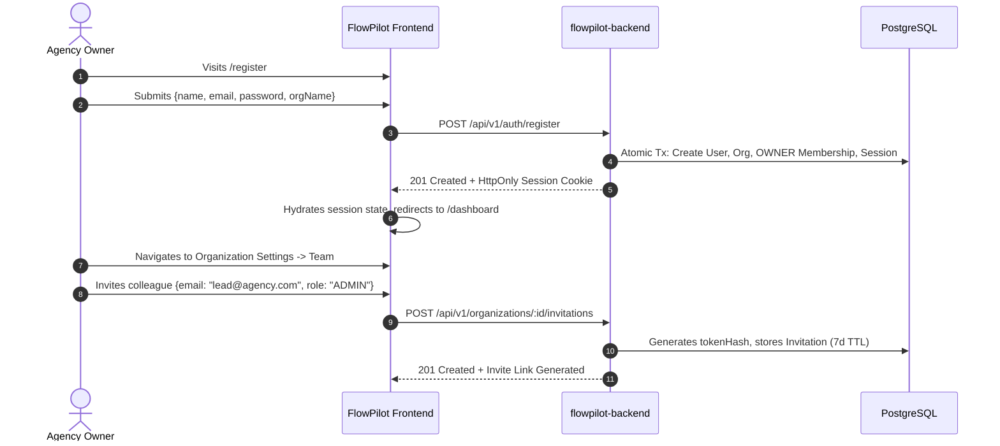
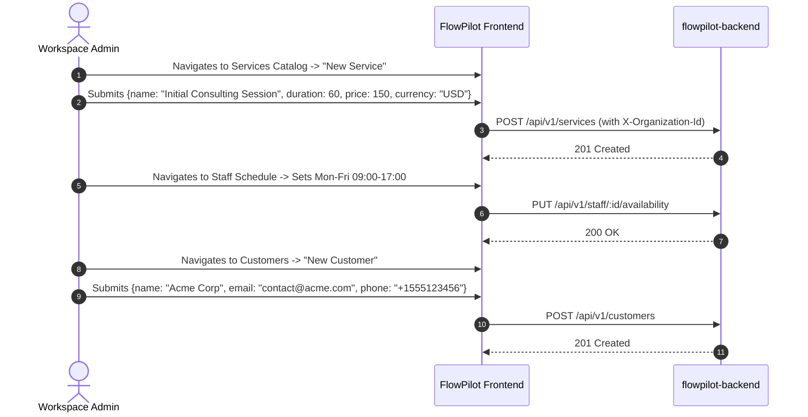
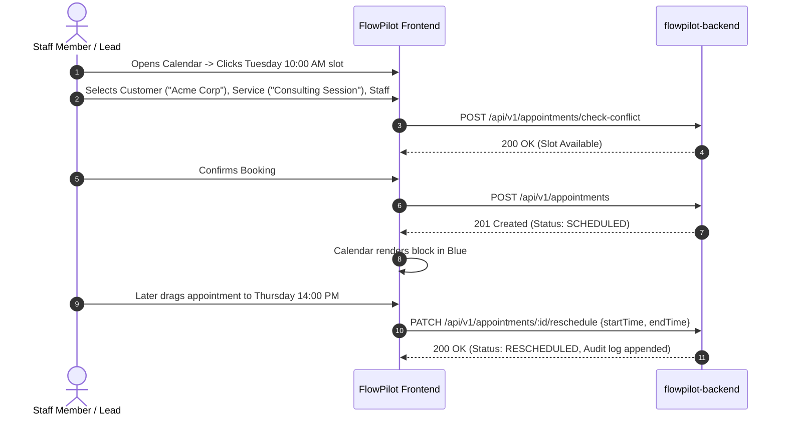
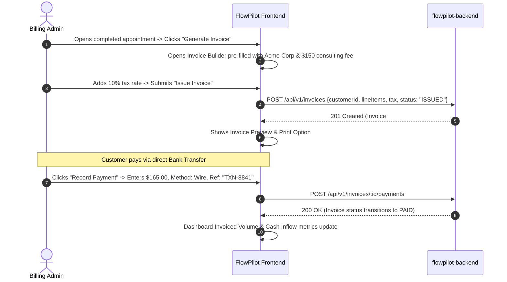

# FlowPilot — Product Scope, Delivery Phases & User Journeys

> **Document Version**: 1.0.0  
> **Status**: Strategic Product Architecture Baseline  
> **Product Vision**: "One workspace to run a service business."  
> **Target Audience**: Business Owners, Service Professionals, Agency Operators, Project Stakeholders

---

## 1. Product Scope Strategy & Guiding Principles

FlowPilot is engineered specifically for independent service businesses, agencies, and consulting teams (e.g., IT consultants, marketing agencies, maintenance contractors, physical therapy practices, specialized service firms).

### Core Architectural Principles

1. **The "Single Core Loop" Rule**:
   Every feature in the MVP must directly support the core business loop:
   $$\text{Register} \longrightarrow \text{Configure Services} \longrightarrow \text{Add Customer} \longrightarrow \text{Schedule Appointment} \longrightarrow \text{Issue Invoice} \longrightarrow \text{Record Payment}$$
   Any feature that does not directly accelerate, protect, or complete this loop is deferred to V1 or Future.

2. **Strict Multi-Tenancy & Data Isolation**:
   Every operational entity belongs exclusively to an Organization (`organizationId`). There is zero data leakage across workspaces, and all requests verify server-side authorization.

3. **No Hidden Complexity / Minimal Boilerplate**:
   Avoid over-engineering. Deliver reliable, accessible, responsive CRUD with robust validation and empty/loading/error feedback before introducing complex automations.

4. **Clear Domain Boundary: Invoicing vs. Platform Billing**:
   - **Customer Business Invoicing (`INV`)**: Invoices that FlowPilot users issue to their end-clients for services rendered (tracked with manual payment reconciliation).
   - **FlowPilot SaaS Subscription (`BILL`)**: What FlowPilot users pay to FlowPilot for software access, seats, and usage quotas.

---

## 2. Product Phasing Roadmap (MVP vs. V1 vs. Future)



### 2.1 In-Scope for MVP (Phase 1 — 56 Features)

The Minimum Viable Product (MVP) delivers a self-contained, end-to-end operational operating system for service teams:

- **Authentication & Multi-Tenant Boundaries**: Email/password login, registration with automatic organization provisioning, session restoration via `/me`, server-side session invalidation, and strict tenant switching.
- **Organization & Role Management**: Workspace profile editing (name, ISO currency, IANA timezone), team member listing, role assignment (`OWNER`, `ADMIN`, `MEMBER`, `BILLING`), and secure single-use invitation links.
- **Customer CRM**: Centralized directory with search, creation, editing, customer notes, and historical activity views.
- **Service Catalog & Staff Availability**: Definition of services, durations, base pricing, qualified staff mappings, and staff weekly operating hours.
- **Appointment Scheduling**: Interactive operational calendar (Day, Week, Month), conflict detection preventing double-booking, detail inspector, rescheduling, cancellation, and status transitions.
- **Invoicing & Cash Flow**: Line-item invoice builder with taxes and discounts, 1-click generation from completed appointments, PDF preview/print, and manual payment logging.
- **Workspace Dashboard**: Key performance metric cards, today's schedule glance, and recent activity feed.

### 2.2 In-Scope for V1 (Phase 2 — 21 Features)

The V1 release expands self-service acquisition, automated reminders, platform monetization, and reporting:

- **Public Self-Service Booking Widget**: Shareable link where end-clients can select a service, choose an available staff member and timeslot, and book online.
- **FlowPilot Platform SaaS Billing**: Stripe Billing integration for workspace subscriptions, seat upgrades, quota meters, and grace period enforcement.
- **Automated Email Notifications**: 24-hour advance appointment reminders to clients, team invite emails, and email delivery of invoice PDFs.
- **Business Reporting & Exports**: Cash flow charts, revenue aging reports, staff utilization breakdown, and CSV data export for accounting tools.
- **Organizational Enhancements**: Custom workspace logo upload, customer tagging/segmentation, recurring appointment rules, and multi-workspace creation.

### 2.3 Out-of-Scope / Future Expansion (Phase 3 — 5 Features)

Explicitly excluded from initial development to preserve focus and shipping velocity:

- **End-Client Portal**: Dedicated portal login for end-customers to review invoices and appointments.
- **Project & Task Management**: Kanban boards, task assignments, and Gantt charts.
- **Cloud Document Storage**: Uploading large binary attachments or photos to external S3 buckets.
- **External 2-Way Calendar Sync**: Direct bi-directional synchronization with Google Calendar or Microsoft Outlook via OAuth.
- **SMS Notifications**: SMS text delivery via Twilio or MessageBird.
- **Webhook & Zapier Engine**: Outbound event dispatching to third-party automation tools.

---

## 3. The Four Core End-to-End User Journeys

### User Journey 1: Workspace Owner Onboarding & Team Provisioning



### User Journey 2: Customer CRM & Service Catalog Setup



### User Journey 3: Calendar Scheduling, Booking & Rescheduling



### User Journey 4: Invoice Generation & Manual Payment Reconciliation



---

## 4. Scope Classification Matrix

| Scope Category                        | Definition                                                                                                                | Current Example Features                                                                                                                                                                                                            |
| :------------------------------------ | :------------------------------------------------------------------------------------------------------------------------ | :---------------------------------------------------------------------------------------------------------------------------------------------------------------------------------------------------------------------------------- |
| **Confirmed Requirements**            | Explicitly validated by project documents, existing architecture, and business goals.                                     | Email/password login, multi-tenant isolation, organization profile (currency/timezone), team roles (`OWNER`, `ADMIN`, `MEMBER`, `BILLING`), CRM customer list, service catalog, calendar scheduling, manual invoice reconciliation. |
| **Existing Implementation**           | Already built in code and verified with automated tests.                                                                  | Tailwind v4 design system, accessible UI primitives, error/empty feedback states, typed `ApiClient`, Argon2id crypto, PostgreSQL session persistence, server-side RBAC middleware.                                                  |
| **Proposed Scope (Needing Approval)** | High-value additions that logically complement the platform but require sign-off before committing engineering resources. | Stripe SaaS Subscription Billing (`BILL-01` to `BILL-04`), Public Online Booking Widget (`SCHED-07`), Automated 24h Email Reminders (`NOTIF-03`), Customer Tagging (`CRM-06`).                                                      |
| **Unknowns & Technical Gaps**         | Areas where requirements are underspecified or third-party dependencies are unchosen.                                     | Transactional email vendor (Resend vs AWS SES), cloud file storage provider for organization logos (AWS S3 vs Cloudflare R2), invoice sequence numbering format customization.                                                      |

---

## 5. In-Scope vs. Out-of-Scope Matrix

```
+------------------------------------------------------------------------------------+
|                               IN-SCOPE (MVP)                                       |
|  - Multi-tenant email/password auth & session cookies                              |
|  - User profile view & update                                                      |
|  - Organization management (name, currency, timezone)                              |
|  - Team member invitations & role management (OWNER, ADMIN, MEMBER, BILLING)       |
|  - Customer CRM directory, detail views, and notes                                 |
|  - Service catalog & staff weekly availability hours                               |
|  - Calendar scheduling (Day/Week/Month) with conflict checking                     |
|  - Line-item invoicing & manual payment logging                                    |
|  - Dashboard metrics & operational activity feed                                   |
+------------------------------------------------------------------------------------+
                                         |
                                         v
+------------------------------------------------------------------------------------+
|                               IN-SCOPE (V1)                                        |
|  - Public client self-service booking widget                                       |
|  - FlowPilot SaaS platform subscriptions (Stripe Billing)                          |
|  - Automated email reminders (24h prior)                                           |
|  - Organization custom logo upload & branding                                      |
|  - Customer tags & segmentation                                                    |
|  - Cash flow & staff utilization reports + CSV export                              |
+------------------------------------------------------------------------------------+
                                         |
                                         v
+------------------------------------------------------------------------------------+
|                            OUT-OF-SCOPE / FUTURE                                   |
|  - Client Self-Service Portal                                                      |
|  - Lightweight Project Kanban boards                                               |
|  - 2-Way Google & Outlook calendar sync                                            |
|  - Cloud document & contract attachments                                           |
|  - SMS alerts & reminders via Twilio                                               |
|  - Webhook & Zapier automations                                                    |
+------------------------------------------------------------------------------------+
```
