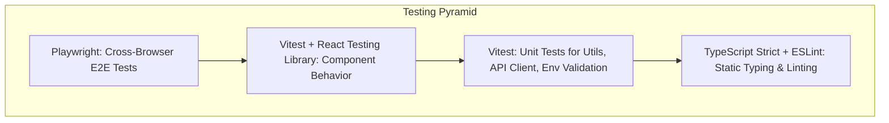

# FlowPilot — Frontend Testing Strategy

> **Document Version**: 1.0.0  
> **Status**: Approved Quality & Testing Baseline  
> **Philosophy**: Test User Behavior & Real Interactions, Not Implementation Details

---

## 1. Testing Pyramid & Tooling Allocation

FlowPilot implements a balanced testing strategy with distinct responsibilities for each tool:

### Tooling Responsibilities

| Tool                      | Responsibility                                            | Execution Speed  | Command                |
| :------------------------ | :-------------------------------------------------------- | :--------------- | :--------------------- |
| **TypeScript (`tsc`)**    | Compile-time type verification, API contract validation   | Ultra-fast (~2s) | `npm run type-check`   |
| **ESLint 9**              | Code style, React hooks rules, accessibility rules        | Fast (~3s)       | `npm run lint`         |
| **Prettier**              | Code style formatting consistency                         | Fast (~1s)       | `npm run format:check` |
| **Vitest 5**              | Unit testing, utility functions, API client error mapping | Fast (~2s)       | `npm run test:unit`    |
| **React Testing Library** | Component rendering, accessibility roles, user events     | Fast (~3s)       | `npm run test:unit`    |
| **Playwright**            | Real browser rendering, routing, navigation smoke tests   | Moderate (~20s)  | `npm run test:e2e`     |

---

## 2. Unit Testing Conventions (Vitest)

Unit tests focus on deterministic logic:

- `src/lib/utils/cn.test.ts`: Verifies class merging, falsy condition handling, and Tailwind class deduplication.
- `src/lib/config/env.test.ts`: Verifies runtime environment variable validation with Zod.
- `src/lib/api/client.test.ts`: Verifies HTTP request headers (`X-Organization-Id`), timeout management, and status-to-error mapping (401, 403, 404, 422).

---

## 3. Component Testing Conventions (React Testing Library)

Rules for component tests:

1. **Query by Accessible Role First**: Prefer `getByRole("button", { name: ... })`, `getByRole("status")`, `getByRole("alert")` over `getByTestId` or class selectors.
2. **Test User Events**: Test what the user does (typing into an input, clicking a button, waiting for a dialog to open).
3. **Verify States**: Verify disabled states, loading spinners (`aria-busy`), and error messages.

---

## 4. End-to-End Testing (Playwright)

Located in `tests/e2e/`:

- Configured in `playwright.config.ts`.
- Automatically spins up the Next.js development server on `http://localhost:3000`.
- Smoke suite (`tests/e2e/smoke.spec.ts`) validates that the root route boots and delivers valid HTML and metadata.

---

## 5. Continuous Integration (CI) Automation

The GitHub Actions workflow (`.github/workflows/ci.yml`) runs on every pull request and push to primary branches:

1. Installs clean dependencies via `npm ci`.
2. Executes `npm run validate` (type-check + lint + format check + unit tests).
3. Executes `npm run build` to confirm production compilation succeeds without errors.
