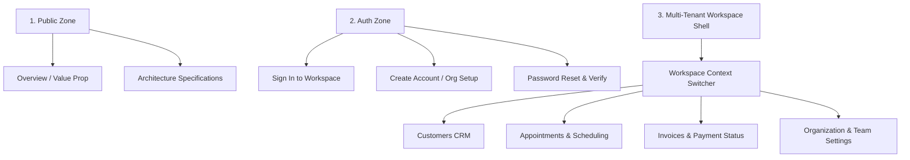

# FlowPilot — UI/UX & Interaction Specification

> **Document Version**: 1.0.0  
> **Status**: Approved Architectural Standard  
> **Target Persona**: Small Service Businesses, Agencies, Consulting Teams  
> **Interaction Standard**: Predictable, Responsive, Resilient

---

## 1. Information Architecture & Navigation

FlowPilot's navigation model is organized into three distinct operational zones:

### Navigation Rules

1. **Tenant Context Persistence**: When working inside a workspace, all routes preserve the tenant context. The top-left organization switcher allows switching between owned or joined workspaces without page reload.
2. **Breadcrumb Trail**: Any detail view (e.g. `/customers/[id]`, `/invoices/[id]`) must expose breadcrumb links returning to the parent directory.
3. **Responsive Breakpoints**:
   - `< 1024px` (Mobile & Tablet): The sidebar collapses into an accessible slide-out navigation drawer.
   - `>= 1024px` (Desktop): The fixed left-hand navigation sidebar remains visible for rapid domain switching.

---

## 2. Mandatory UI State Matrix

Every future data-driven feature view in FlowPilot must implement all 9 operational states:

| UI State                     | Visual Representation                             | Component / Pattern              | User Capability                               |
| :--------------------------- | :------------------------------------------------ | :------------------------------- | :-------------------------------------------- |
| **1. Initial Loading**       | Content skeletons resembling final geometry       | `Skeleton`                       | Non-blocking visual placeholder               |
| **2. Action Pending**        | Button spinner, input field freeze, `aria-busy`   | `Button isLoading`               | Prevents duplicate form submissions           |
| **3. Empty Dataset**         | Centered icon, encouraging prompt, creation CTA   | `EmptyState`                     | Primary button triggers first record creation |
| **4. Validation Error**      | Red field outline, inline error text below field  | `Input hasError`, `role="alert"` | Directs focus to first invalid input field    |
| **5. API Error**             | Alert banner or alert card with error description | `ErrorState`                     | Includes "Try Again" action button            |
| **6. Unauthenticated (401)** | Immediate redirect to login with return URL       | `ApiClient onUnauthorized`       | Preserves intended destination route          |
| **7. Forbidden (403)**       | Informative page stating missing role permissions | `ForbiddenError` view            | Allows contacting workspace owner             |
| **8. Not Found (404)**       | Compass icon, clear message, navigation back      | `not-found.tsx`                  | Link to workspace overview                    |
| **9. Network Disconnection** | Offline warning banner                            | Network event listener           | Data cached locally remains readable          |

---

## 3. Forms & Data Entry Standards

1. **Validation Timing**:
   - Initial validation triggers on form submit (`handleSubmit`).
   - Once a field has reported an error, re-validation triggers on input change/blur so the user receives immediate feedback when corrected.
2. **Accessible Associations**:
   - Every input has an explicit `<Label htmlFor="field-id">` association.
   - Every error message has `id="field-id-error"` and the input binds `aria-describedby="field-id-error"`.
3. **Submission State**:
   - Submitting disables the submit button and activates the spinner.
   - Prevents double-clicking and multiple pending mutations.
4. **Success Feedback**:
   - Successful actions provide non-blocking toast notifications or transition to the updated resource view.

---

## 4. Tables & Data-Dense View Standards

For invoices, appointment logs, and customer CRM directories:

1. **Server-Side Pagination**:
   - Large datasets are paged at 10, 25, or 50 records per page.
   - Query parameters `?page=1&limit=25` are synchronized with URL query params.
2. **Column Alignment**:
   - Text (names, descriptions, emails): **Left aligned**.
   - Numbers, counts, currency amounts: **Right aligned** (`tabular-nums` for aligned digits).
   - Status badges and action buttons: **Center / Right aligned**.
3. **Empty Results vs. No Filter Matches**:
   - If a table has zero total records, show the `EmptyState` component with a creation CTA.
   - If records exist but a search filter returns zero hits, show a "No matching results found for '{query}'" state with a "Clear Filters" button.

---

## 5. Destructive Action Confirmation

All non-recoverable actions (deleting an invoice draft, cancelling a customer membership, revoking access) require explicit user confirmation:

- Trigger an accessible modal dialog (`Dialog`).
- Clearly state the impact (e.g. _"This action cannot be undone. All scheduled appointments for this customer will also be cancelled."_).
- Confirm button must use `variant="destructive"` to reinforce caution.
- Provide a clear "Cancel" button that returns focus to the trigger.
