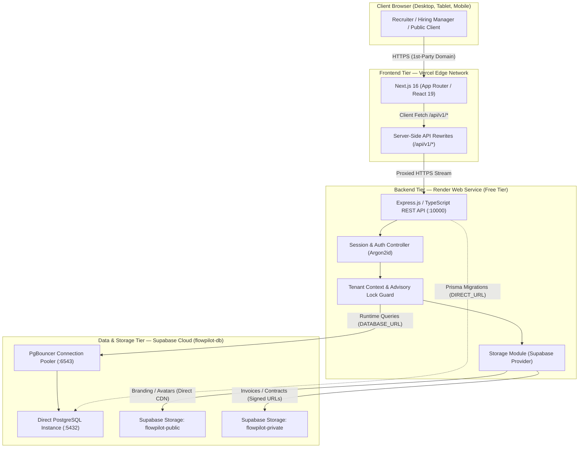

# FlowPilot — Portfolio Demo Deployment Architecture

**Target Deployment Model:** Portfolio Demo & Technical Showcase  
**Architecture Pipeline:** `Vercel (Frontend) → Render (Backend) → Supabase (PostgreSQL & Storage)`  
**Domain Model:** Vercel-provided default domain (`https://*.vercel.app`) + Render web service domain (`https://*.onrender.com`)  
**Cost Target:** \$0 initial recurring cost (Free tier eligible)

---

## 1. High-Level Architecture Overview

FlowPilot is deployed as a decoupled multi-tenant SaaS architecture optimized for zero/low infrastructure cost while preserving strict production engineering standards, full-stack multi-tenancy, and high reliability.

---

## 2. Component Breakdown & Hosting Roles

### 2.1 Frontend — Vercel

- **Repository:** `iamrakibhussain/flowpilot`
- **Framework:** Next.js 16.4.2 (App Router), React 19.3.0, Tailwind CSS 4, Radix UI.
- **Hosting Tier:** Vercel Hobby (Free).
- **Domain:** Default Vercel domain (e.g. `flowpilot-demo.vercel.app`).
- **Networking Strategy (Recommended):**
  - Next.js Server-Side Rewrites in `next.config.ts` route `/api/v1/:path*` directly to `BACKEND_API_URL` on Render.
  - **Crucial Benefit:** Browsers treat all API communication as **same-origin** (`https://flowpilot-demo.vercel.app`). This completely avoids third-party cookie restrictions (Safari ITP, Chrome Privacy Sandbox) and allows standard `SameSite=Lax` or `Strict` cookies to operate without cross-site blocking.

### 2.2 Backend — Render

- **Repository:** `iamrakibhussain/flowpilot-backend`
- **Runtime:** Node.js 20+ LTS, Express 4.21.2, TypeScript 5.7+ (Strict Mode).
- **Hosting Tier:** Render Web Service (Free tier, 512 MB RAM, 0.1 CPU).
- **Health Check Endpoint:** `GET /api/v1/health` (HTTP 200).
- **Reverse Proxy Trust:** `TRUST_PROXY=1` (Render acts as single-hop reverse proxy).
- **Blueprint:** Declaratively managed via `render.yaml`.

### 2.3 Database — Supabase (`flowpilot-db`)

- **Engine:** PostgreSQL 15+ managed by Supabase.
- **Project:** Single existing Supabase project `flowpilot-db` (`emahsbgbbujiedhlddhb`).
- **Multi-Tenant Isolation:** Complete isolation between organizations enforced in application and database logic via `organizationId` scoping, rather than physical database separation.
- **Dual Connection String Configuration:**
  - `DATABASE_URL`: Transaction-mode connection pooler (`port 6543`) with `?pgbouncer=true&connection_limit=1`.
  - `DIRECT_URL`: Session-mode direct PostgreSQL connection (`port 5432`) used exclusively for `npx prisma migrate deploy` and schema synchronization.

### 2.4 Object Storage — Supabase Storage

- **Buckets:**
  - `flowpilot-public`: Public logos, branding banners, and specialist avatars (direct CDN delivery).
  - `flowpilot-private`: Customer invoices, signed PDF contracts, and audit trails (served via temporary 900s cryptographic signed URLs).
- **Security:** Service-role key (`SUPABASE_SERVICE_ROLE_KEY`) is strictly confined to the backend server and never leaked to the client bundle.

---

## 3. Cookie & Authentication Strategy

FlowPilot enforces stateful, cryptographically secure session management:

1. **Cookie Structure:**
   - Name: `flowpilot_session`
   - Attributes: `HttpOnly; Path=/; Secure; SameSite=Lax` (or `SameSite=Strict`).
   - Session storage: Persistent sessions stored in PostgreSQL `Session` table with 7-day TTL and rolling activity refresh.
2. **Reverse Proxy vs Direct CORS:**
   - **Mode A: Next.js Rewrites (Recommended):**
     - Frontend URL: `https://flowpilot-demo.vercel.app`
     - API calls go to: `https://flowpilot-demo.vercel.app/api/v1/*`
     - Rewrites transparently proxy to: `https://flowpilot-backend.onrender.com/api/v1/*`
     - Cookie is 1st-party to `flowpilot-demo.vercel.app`.
   - **Mode B: Direct Cross-Origin:**
     - Frontend URL: `https://flowpilot-demo.vercel.app`
     - API calls go directly to: `https://flowpilot-backend.onrender.com/api/v1/*`
     - Backend environment requires: `COOKIE_SAME_SITE=none` and `CORS_ORIGIN=https://flowpilot-demo.vercel.app`.
     - Cookie is sent with `SameSite=None; Secure`.

---

## 4. Background Job & Scheduler Behavior on Free Tier

- **Implementation:** In-process `setInterval` timers in `src/server.ts` (Reminders: 15m, Recurring billing: 15m, Session cleanup: 60m).
- **Render Free Tier Reality:**
  - Render Free Web Services sleep after 15 minutes of inbound HTTP inactivity.
  - While sleeping, in-process timers are paused.
  - Upon an incoming HTTP request, the instance wakes up (initial cold start: ~30-50 seconds).
- **Portfolio Demo Safeguard:**
  - For the portfolio demo, `ENABLE_BACKGROUND_JOBS=false` is configured in `render.yaml`.
  - This prevents sleep/wake timer races from firing duplicate billing cycles or sending automated reminder emails unexpectedly.
  - Manual triggers remain fully functional via authenticated routes (`/api/v1/notifications/trigger-reminders`, `/api/v1/recurring/process-now`) restricted to authorized `OWNER`/`ADMIN` roles.
